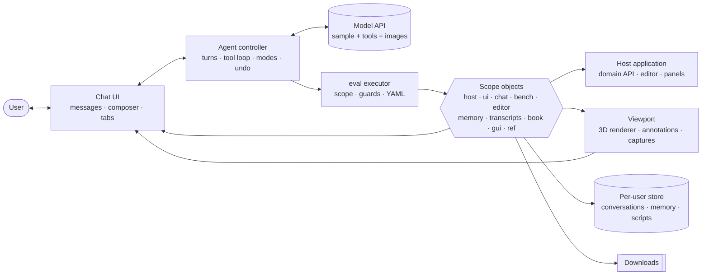
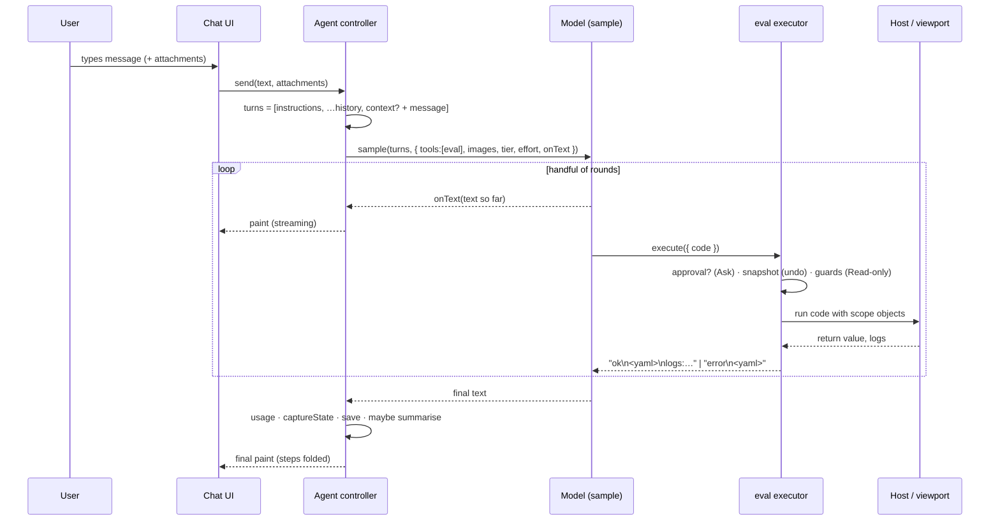
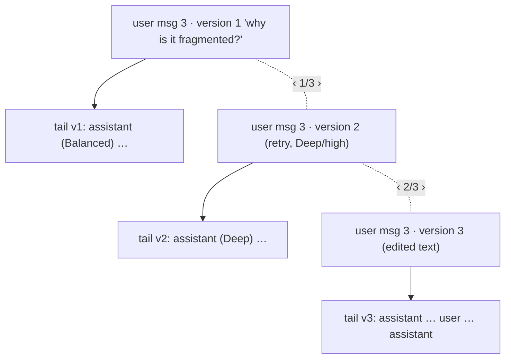
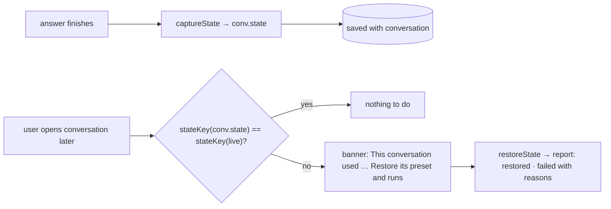
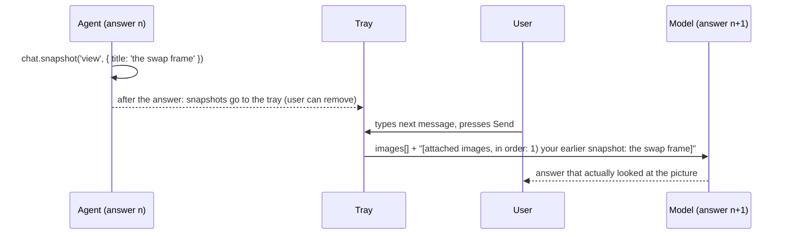
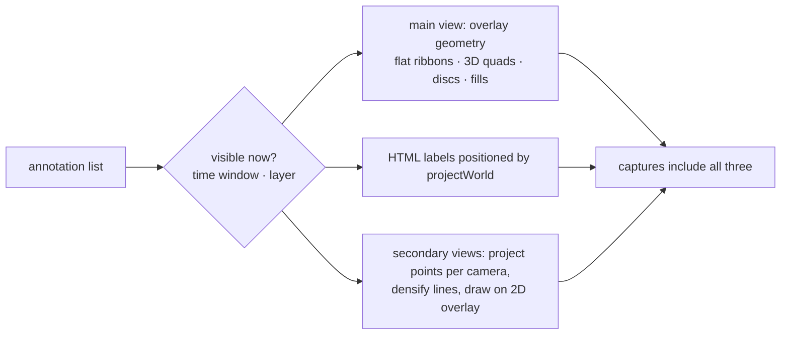
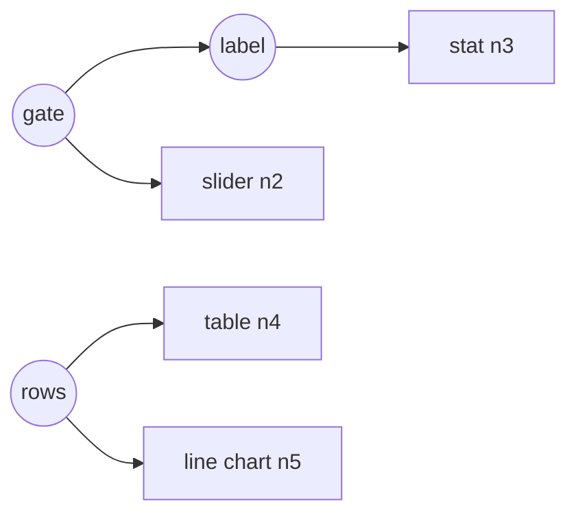

# Agent runtime spec: a portable chat agent with a single `eval()` tool

This document describes the agent layer of the tracking workbench with the tracking domain removed, so it can be rebuilt in another browser project that also exposes a JavaScript API. It covers the chat runtime, the one tool the model has (`eval`), how the agent reads and changes the host application, memory and transcripts, visual output, images in both directions, a 3D viewport with annotations and captures, generative UI, and the safety model around all of it.

Everything here was built and tested in the workbench. Where the original used domain names (`wb`, `ws`, runs, cameras), this spec uses `host` for "the project's own API" and notes the original in passing.

## Contents

1. [Concepts](#1-concepts)
2. [Architecture](#2-architecture)
3. [Host contract](#3-host-contract)
4. [The agent loop](#4-the-agent-loop)
5. [The eval tool](#5-the-eval-tool)
6. [Safety: run modes, privileges, undo](#6-safety-run-modes-privileges-undo)
7. [State introspection: `bench`](#7-state-introspection-bench)
8. [Editor and script library: `editor`](#8-editor-and-script-library-editor)
9. [Chat data model and rendering](#9-chat-data-model-and-rendering)
10. [Branches: edit, retry, versions](#10-branches-edit-retry-versions)
11. [Conversations: storage, history, summaries, usage](#11-conversations-storage-history-summaries-usage)
12. [Transcripts API](#12-transcripts-api)
13. [Saving and restoring host state](#13-saving-and-restoring-host-state)
14. [Memory](#14-memory)
15. [Visual output: `chat`](#15-visual-output-chat)
16. [Images into the model](#16-images-into-the-model)
17. [Viewport and 3D scene: `ui`](#17-viewport-and-3d-scene-ui)
18. [Annotations](#18-annotations)
19. [Captures](#19-captures)
20. [Tours](#20-tours)
21. [Generative UI: `gui`](#21-generative-ui-gui)
22. [Clickable references](#22-clickable-references)
23. [Documentation access: `book`](#23-documentation-access-book)
24. [Instructions template](#24-instructions-template)
25. [Testing without a live model](#25-testing-without-a-live-model)
26. [Pitfalls found while building](#26-pitfalls-found-while-building)
27. [Porting checklist](#27-porting-checklist)

---

## 1. Concepts

**Code as the only action.** The model gets exactly one tool, `eval(code)`. Everything it does (read state, change the scene, render a chart, save a memory, offer a file) is a call on a JavaScript API inside that code. New capabilities are new API functions, not new tools, so the tool surface never changes and the model can combine calls freely in one step.

**Scope objects.** `eval` code runs as the body of an async function with a fixed set of named objects in scope. Each object is a namespace with a clear job:

| Object | Job |
| --- | --- |
| `host` | The project's own domain API (in the workbench: `wb` grammar + `ws` workspace). |
| `ui` | Drives the screen: viewport, time, selection, layers, panels, annotations, tours. |
| `chat` | Puts things into the conversation: charts, tables, snapshots, files, apps, tours. |
| `bench` | Reads application state on demand. |
| `editor` | Reads, writes, runs and saves user scripts. |
| `memory` | Long-term notes and runnable skills for this user. |
| `transcripts` | Earlier conversations, including the current one. |
| `book` | Searchable bundled documentation. |
| `gui` | Builder for small interactive apps (generative UI). |
| `ref` | Builds clickable links that act on the application. |
| `log`, `console` | Captured output returned with the result. |

**Pull, not push.** The model is not handed the whole application state every turn. Each message carries a compact summary only when it changed; anything else the agent asks for through `bench`, `editor`, `transcripts` and the host API. This keeps prompts small and lets the agent decide what it needs.

**Results come back small.** Return values are serialised to YAML and truncated near 9,000 characters. The instructions tell the agent to return specific, small data. Large artefacts go to the screen (`ui`, `chat`) or into files (`chat.download`), never through the tool result.

**Show, don't only tell.** The agent is expected to put evidence on screen: seek to the moment it is talking about, annotate the scene, render a chart, link the frame. Answers contain clickable references that reproduce what the agent looked at.

**Everything durable is per-user and private.** Conversations, memories and saved scripts live in a per-user store, with browser storage as a fallback. Nothing is shared unless exported.

**Safety is structural.** Three run modes (Auto, Ask, Read-only), privilege gates for sensitive data, and a snapshot before every step so any step or whole answer can be undone.

**Lambdas are data.** Functions the agent hands to long-lived things (generative UI handlers, derived values, drawing code) are stored as source text and rehydrated without closures. They survive reloads, can be inspected, and cannot silently capture agent-scope variables.

---

## 2. Architecture



The page layout the workbench used (the agent panel is independent of the rest and can be docked anywhere):

```
┌──────────────────────────────────────────────────────────────────────────────┐
│ top bar: title · preset/script · Run · run chips · view mode · layers · theme │
├────────────┬───────────────────────────────────────────┬─────────────────────┤
│ left:      │ viewport (3D scene, labels, note, tour)   │ agent:              │
│ scripts ·  │                         ┌──────────────┐  │  header (title,     │
│ editor ·   │                         │ secondary    │  │   new, history, ⤓)  │
│ docs ·     │                         │ views        │  │  settings row       │
│ reference  │                         └──────────────┘  │  Chat | Memory tabs │
│            ├───────────────────────────────────────────┤  messages           │
│            │ timeline                                  │  attachment tray    │
│            ├───────────────────────────────────────────┤  composer           │
│            │ panels (… · App)                          │                     │
└────────────┴───────────────────────────────────────────┴─────────────────────┘
```

Load order of the original modules, which is a reasonable order for a port:

```
model + storage capabilities (async)      → claude.use('sample'|'db'|'user'|'downloads')
host engine (pure JS, no DOM)             → domain API
app core                                  → state, layout, editor, console, ui API, storage, markdown, YAML
viewport                                  → renderer, overlays, labels, annotations, captures
panels                                    → host-specific views (exported renderers reused by chat)
docs                                      → book index and reader
gui                                       → generative UI, tours, App panel
agent                                     → chat, eval, memory, transcripts, history, boot
```

---

## 3. Host contract

What the environment must provide. The workbench ran as a published claude.ai artifact, which supplies the first four through `window.claude.use(name)`.

### 3.1 Platform capabilities

| Capability | Used for | Declared as |
| --- | --- | --- |
| `sample` | Model calls with the `eval` tool, streaming text, image input | `"sample": { "images": true }` |
| `db` | Per-user documents: conversations, memory, scripts | `"db": {}` |
| `user` | The viewer's stable id, for private paths | `"user": {}` |
| `downloads` | Saving files the agent or an app offers | `"downloads": true` |

```ts
// what the runtime expects from the platform (all optional at runtime; the UI degrades)
interface Platform {
  sample?: SampleFn & { limits(): Promise<Limits> };
  db?: DB;                       // document store with collections
  user?: { id(): Promise<string> };
  downloads?: { save(o: { filename: string; data: Blob }): Promise<void> };
}
interface Limits {
  maxPromptBytes: number;
  tools?: { maxCount: number };                 // absent → this view cannot run tools
  images?: { maxCount: number; maxInputBytes: number; mediaTypes: string[] };
}
type SampleFn = (input: string | Turn[], options: SampleOptions) => Promise<SampleResult>;
interface SampleOptions {
  signal?: AbortSignal;
  onText?: (e: { text: string; delta: string }) => void;   // text of every round so far
  modelTier?: 'quick' | 'default' | 'complex';
  effort?: 'low' | 'medium' | 'high';                      // not for 'quick'
  tools?: Tool[];
  images?: Blob[];                                         // attached to the final user turn
  cache?: false;                                           // calls with tools are never cached
}
interface Tool { name: string; description: string; inputSchema: object; execute(input: any, ctx: { signal: AbortSignal }): Promise<string>; }
interface SampleResult { text: string; truncated: boolean; modelTierApplied?: string; }
```

**Evaluation must be allowed.** The runtime compiles code with `new Function`. Check once at boot (`(0, eval)('1+1') === 2` in a try/catch). If a content-security policy blocks it, built-in scripts can still run as real functions, but the agent's tool and edited scripts cannot; say so in the UI rather than failing silently.

**Storage path rules** (the platform's database): collection paths have an odd number of segments, document paths an even number. `data/users/<id>` is the viewer's private area. The runtime uses one document under it and subcollections beneath:

```
data/users/<id>/workbench              ← document (4 segments)
data/users/<id>/workbench/transcripts  ← collection (5 segments) · one doc per conversation
data/users/<id>/workbench/presets      ← collection · saved scripts
data/users/<id>/workbench/memory       ← collection · memories
```

> A 4-segment path like `data/users/<id>/presets` is a document, not a collection, and `collection()` throws. Catching that silently and falling back to browser storage hid the bug for a while (see [Pitfalls](#26-pitfalls-found-while-building)).

### 3.2 Hooks the host application implements

```ts
interface HostHooks {
  /** Compact summary sent with a user message when it changed (≈ 600 chars). */
  contextSummary(): object;
  /** Full state for bench.state(). */
  state(): object;
  /** Snapshot and restore for undo (in memory, fast, may hold references). */
  snapshot(): Snapshot;
  restore(s: Snapshot): Promise<void>;
  /** Serialisable state saved with a conversation, and rebuilt from it. */
  captureState(): SavedState;          // JSON only, ≤ 200 KB
  restoreState(s: SavedState): Promise<RestoreReport>;
  /** Identity of what the state refers to, to detect mismatches (e.g. "preset + run ids/labels"). */
  stateKey(s?: SavedState): string;
  /** Domain objects put into eval scope (one or more names). */
  scope(): Record<string, unknown>;
  /** Reference actions (see §22). */
  handleRef(action: string, params: URLSearchParams, el?: Element): void;
}
interface ViewportHooks {
  snapshot(target: string): HTMLCanvasElement | null;      // 'view' | 'floor' | 'camera:<id>' | …
  projectWorld(p: [number, number, number]): { x: number; y: number; behind: boolean };
  resolveAnchor(a: Anchor, t: number): [number, number, number | null] | null;
  secondaryViews(): { id: string; project(p: Vec3): { u: number; v: number } | null }[];
}
```

---

## 4. The agent loop

### 4.1 One message, end to end



### 4.2 Sending

```js
async function send(){
  if (busy) return abortController.abort();               // the Send button doubles as Stop
  const text = composer.value.trim(); if (!text) return;
  const att = tray.splice(0, limits.images?.maxCount ?? 0); // attachments for this message
  await sendCore(text, { att });
}

async function sendCore(text, { att = [], reuse = null, override = null } = {}){
  const conv = current;
  if (!conv.messages.length && !conv.titleBy) conv.title = clip(text, 60);
  const attNote = att.length ? `\n\n[attached images, in order: ${captions(att)}]` : '';
  const upto = reuse ?? conv.messages.length;              // history = messages before this one
  const { turns, ctx } = turnsFor(text + attNote, conv, upto);
  if (reuse == null) conv.messages.push({ role: 'user', text, thumbs: await thumbs(att), ctx, at: now() });
  const set = { ...settings, ...override };                 // tier, effort, mode
  const msg = { role: 'assistant', text: '', parts: [], pending: true, at: now(), ...pick(set, 'tier', 'effort', 'mode') };
  conv.messages.push(msg); busy = true; paint();
  try {
    const r = await sample(turns, {
      signal, modelTier: set.tier, ...(set.tier !== 'quick' && { effort: set.effort }),
      onText: ({ text }) => { msg.text = text; paint(); },
      ...(att.length && { images: att.map(a => a.blob ?? dataUrlToBlob(a.src)) }),
      ...(toolsAvailable ? { tools: [evalTool(msg)] } : { cache: false }),
    });
    Object.assign(msg, { text: r.text, truncated: r.truncated, tierApplied: r.modelTierApplied });
  } catch (e){ msg.error = friendly(e); if (e.text != null) msg.text = e.text; }
  finally {
    msg.pending = false; msg.doneAt = now();
    msg.usage = { evals: steps(msg).length, evalMs: sum(steps(msg), 'ms'), ms: msg.doneAt - msg.at };
    conv.usage = convUsage(conv); conv.state = host.captureState();
    busy = false; paint(); save(conv);
    attachAgentSnapshotsToTray(msg);                       // §16
    if (!msg.error) maybeSummarize(conv);                  // §11.4
  }
}
```

### 4.3 Turns

The model API is stateless, so every call sends the instructions and a window of history.

```js
const HISTORY = 16;                                         // messages
function turnsFor(text, conv, upto){
  const win = conv.messages.slice(0, upto).slice(-HISTORY), hist = [];
  for (const m of win){
    if (m.role === 'user') hist.push({ role: 'user', content: (m.ctx ? `[context]\n${m.ctx}\n\n` : '') + m.text });
    else {
      let c = m.text || '';
      for (const p of steps(m)) c += `\n[eval]\n${clip(p.code, 1500)}\n→ ${p.status}:\n${clip(p.result, 900)}`
                                   + (p.reverted ? '\n[the user reverted this step and everything after it]' : '');
      if (c.trim()) hist.push({ role: 'assistant', content: clip(c, 12000) });
    }
  }
  while (hist.length && hist[0].role !== 'user') hist.shift();
  // context only when it differs from the last one still visible in the window
  const ctx = JSON.stringify(host.contextSummary());
  const last = [...win].reverse().find(m => m.role === 'user' && m.ctx);
  const changed = !last || last.ctx !== ctx;
  const head = changed ? `[context]\n${ctx}` : '[context unchanged since your last message; query bench.* for more]';
  const turns = [{ role: 'user', content: instructions() }, ...hist, { role: 'user', content: `${head}\n\n[user message]\n${text}` }];
  while (bytes(turns) > 230_000 && turns.length > 3) turns.splice(1, 1);   // drop oldest history first
  return { turns, ctx: changed ? ctx : null };
}
```

- The instructions go in a leading user turn, rebuilt on every call (§24), because they contain live facts: conversation id and summary, run mode, pinned memories, privilege grants.
- Earlier tool steps are summarised in the assistant turns so the agent remembers what it ran and what came back.
- Messages that carried a context block store it (`m.ctx`) so the history shows it and "unchanged" is meaningful.

### 4.4 Settings and errors

| Setting | Values | Effect |
| --- | --- | --- |
| Model | Fast · Balanced · Deep | `modelTier` quick · default · complex |
| Thinking | Low · Medium · High | `effort` (disabled for Fast) |
| Run mode | Auto · Ask · Read-only | §6 |
| Privilege toggle | on · off | e.g. "may read reference truth" (§6.2) |
| Memory saves | directly · after I approve | §14.6 |

Map platform error codes to plain messages, and keep partial text on failure:

| Code | Message |
| --- | --- |
| `cancelled` | "Stopped." |
| `not_granted` | Allow Claude for this page when asked. |
| `rate_limited` | Too many requests or usage limit reached. Try again later. |
| `prompt_too_large` | The conversation is too long. Start a new one. |
| `refused` | Claude declined this request. Rephrase it. (Drop partial text.) |
| `images_unavailable` | This view cannot send images (hide the attach button). |
| `image_rejected` | One attached image was refused. Remove it and try again. |
| other | "Something went wrong (<code>). Try again." |

---

## 5. The eval tool

### 5.1 Definition

```js
const evalTool = msg => ({
  name: 'eval',
  description: 'Run JavaScript in the page as the body of an async function. Scope: host, ui, chat, bench, editor, '
             + 'memory, transcripts, book, gui, ref, log, console. Returns "ok" plus a YAML summary of the returned '
             + 'value (a string comes back verbatim) and captured logs, truncated near 9,000 characters; or "error" '
             + 'with the message and line.',
  inputSchema: { type: 'object', properties: { code: { type: 'string', description: 'JavaScript statements; use await; end with return <small value>' } }, required: ['code'] },
  execute: (input, ctx) => runEval(String(input?.code ?? ''), ctx?.signal, msg),
});
```

### 5.2 Execution

```js
async function runEval(code, signal, msg){
  const part = { type: 'tool', code, status: 'run', at: msg.text.length, t0: now() };
  msg.parts.push(part); paint();

  const mode = msg.mode ?? settings.mode;
  if (mode === 'ask' && !msg.approveAll){                       // §6.1
    const d = await askApproval(part, signal);                   // 'run' | 'all' | 'deny'
    if (d === 'deny') return finish(part, false, yaml({ declined: true }), 'The user declined this step.');
    if (d === 'all') msg.approveAll = true;
  }
  if (mode !== 'readonly') SNAPS.set(part, host.snapshot());    // §6.3 undo

  const logs = [], log = (...a) => logs.push(fmt(a));
  const names = ['host', 'ui', 'chat', 'bench', 'editor', 'memory', 'transcripts', 'book', 'gui', 'ref', 'log', 'console'];
  let values = scopeFor(msg, mode, log);                         // read-only mode wraps mutators (§6.1)
  setPrincipal('agent', { privileged: settings.privileged });    // §6.2
  let ok = true, out, lang = 'yaml';
  try {
    const fn = new Function(...names, `"use strict";return (async () => {\n${code}\n})();\n//# sourceURL=agent-eval.js`);
    const res = await fn(...values);
    if (res === undefined) out = '# returned undefined';
    else if (typeof res === 'string'){ out = res; lang = 'text'; }
    else out = toYAML(plain(res, 7));
  } catch (e){
    ok = false;
    const line = (String(e.stack).match(/agent-eval\.js:(\d+)/) || [])[1];
    out = toYAML({ error: `${e.name}: ${e.message}`, ...(line && { line: line - LINE_OFFSET }) });
  } finally { setPrincipal('user'); }
  if (out.length > 9000) out = out.slice(0, 9000) + `\n# … truncated: ${out.length - 9000} more characters`;
  Object.assign(part, { status: ok ? 'ok' : 'err', ms: now() - part.t0, result: out, lang, logs: clip(logs.join('\n'), 6000) });
  refreshScreen(); paint();
  if (signal?.aborted) throw new Error('stopped');
  return `${ok ? 'ok' : 'error'}\n${out}${part.logs ? `\nlogs:\n${part.logs}` : ''}`.slice(0, 28000);
}
```

- **Line numbers.** The `//# sourceURL` makes the code appear as `agent-eval.js` in stack traces. `LINE_OFFSET` is measured once at boot by throwing from line 1 of a probe function compiled the same way.
- **`plain(value, depth)`** walks the value: calls `toJSON()` when present (so domain objects can control their summary), drops keys starting with `_`, caps arrays at 40 items and objects at 40 keys, marks cycles, and renders functions as `ƒ name`.
- **YAML, not JSON.** It is shorter and easier for both the model and the user to read. Multiline strings become block scalars (`|-`), short scalar arrays become flow lists, and strings that would be ambiguous are quoted. The same serialiser and a highlighter render results in the chat.

```yaml
ok
runs:
  - id: A
    label: greedy
    fragments: 4
  - id: B
    label: global
    fragments: 0
trace: |-
  Frame 33 · cam1 · stamp 4.125 s
  T1 lost  pred [634 177 669 334]
nums: [1, 2.5, -3]
```

### 5.3 What good eval code looks like

```js
// one step that looks, acts, shows and returns a small answer
const before = bench.selection();
const r = await host.runSomething({ setting: 0.3 });         // domain call
ui.seek({ timeS: r.firstProblemAt }); ui.select({ id: r.entity });
ui.annotate.text({ entity: r.entity }, 'problem starts here', { group: 'agent' });
chat.snapshot('view', { title: 'where it goes wrong' });
return { problemAt: r.firstProblemAt, entity: r.entity, link: ref.seek({ t: r.firstProblemAt }) };
```

The instructions tell the agent to prefer one eval that does several things, to read error messages and retry (the APIs name the right call in their errors), and never to return whole objects.

---

## 6. Safety: run modes, privileges, undo

### 6.1 Run modes

| Mode | The agent may | Mechanism |
| --- | --- | --- |
| **Auto** | Run anything; the user can undo any step afterwards. | Snapshot before every step. |
| **Ask** | Run a step only after the user approves it. | Each eval waits on an approval card: Run · Run all in this answer · Decline. |
| **Read-only** | Query, compute, explain, navigate the view; not change state. | Mutating functions are replaced by ones that throw `WbReadOnlyError` with an explanation. |

The current mode is stated in the instructions so the agent adapts (in Ask mode it batches work into fewer, clearer steps).

```js
// Ask: the step waits for the user
function askApproval(part, signal){
  part.status = 'ask'; part.open = true; paint();             // card shows the code and three buttons
  return new Promise(resolve => {
    PENDING.set(part, resolve);                                // buttons call PENDING.get(part)(choice)
    signal?.addEventListener('abort', () => resolve('deny'), { once: true });
  });
}

// Read-only: wrap mutators; everything else passes through
function RO(obj, names, what){
  const o = Object.create(obj);
  for (const n of names) o[n] = () => { const e = new Error(`${what}.${n} is blocked in Read-only mode. Explain what you would do instead, or ask the user to switch to Auto or Ask.`); e.name = 'WbReadOnlyError'; throw e; };
  return o;
}
function scopeFor(msg, mode, log){
  let editor = EDITOR, memory = makeMemory(msg), transcripts = TRANSCRIPTS, ui = Object.create(UI);
  let host = HOST;
  if (mode === 'readonly'){
    editor = RO(EDITOR, ['set', 'run', 'save', 'load', 'deleteMyPreset'], 'editor');
    memory = RO(memory, ['save', 'update', 'remove', 'run'], 'memory');
    transcripts = RO(TRANSCRIPTS, ['update', 'restore'], 'transcripts');
    ui.annotate = RO(UI.annotate, ['line', 'arrow', 'circle', 'polygon', 'rect', 'point', 'text', 'update', 'remove', 'clear'], 'ui.annotate');
    host = new Proxy(HOST, { get: (t, k) => HOST_MUTATORS.includes(k) ? RO({}, [k], 'host')[k] : typeof t[k] === 'function' ? t[k].bind(t) : t[k] });
  }
  return [host, ui, makeChat(msg), BENCH, editor, memory, transcripts, BOOK, GUI, REF, log, captureConsole(log)];
}
```

Navigation (`ui.seek`, `ui.select`, `ui.layers`) stays allowed in Read-only: it changes what the user sees, not what they have.

### 6.2 Privileges and principals

Some data or actions should need an explicit grant (in the workbench: reading reference truth and running oracle methods). The runtime tracks who is running code:

```js
const ENV = { principal: 'user', privileged: false };
function setPrincipal(p, o = {}){ ENV.principal = p; ENV.privileged = !!o.privileged; }
function requirePrivilege(what){
  if (ENV.principal === 'agent' && !ENV.privileged)
    throw new WbCapabilityError(`${what} needs the privileged capability, which the agent does not have. Ask the user to switch it on.`);
}
// host getters call requirePrivilege('Reading dataset.truth'), etc.
```

- The grant is a toggle in the agent settings, defaulting to off, and its state is written into the instructions.
- Code the user runs (editor scripts, clicks in generated apps) runs as `user`.
- Privileged results carry a visible badge wherever they appear, so an upper bound is never read as a result.

### 6.3 Undo

A snapshot is taken before each eval that can change things (not in Read-only). Snapshots hold references, live only in memory, and disappear on reload.

```js
const SNAPS = new WeakMap();                       // tool part → snapshot
// host.snapshot() in the workbench captured:
//   editor script + loaded script record · layer settings · annotations · run registry + id counter
//   · shown runs · time · focus · selection · clock definitions · all memories (deep copy)
async function revertFrom(msg, part){
  const steps = msg.parts.filter(p => p.type === 'tool'), k = steps.indexOf(part);
  await host.restore(SNAPS.get(part));
  for (const p of steps.slice(k)) p.reverted = true;    // marked for the user and in the agent's history
  paint(); save(current);
}
```

- **Revert to before this step** appears on every finished step that has a snapshot; **Undo this answer** reverts from the first step.
- Memory is restored by diffing: delete memories that did not exist, re-save ones that changed.
- Saved scripts are not part of the snapshot (the agent saves them only when asked); say so in the docs.

---

## 7. State introspection: `bench`

```ts
interface Bench {
  context(): object;                       // the compact summary sent with messages (also below)
  state(): object;                         // full UI and host state
  editor(): { title: string | null; presetId: string | null; kind: 'builtin' | 'mine' | 'scratch' | 'new';
              modified: boolean; saved: boolean; lines: number; code: string };
  console(o?: { last?: number; errorsOnly?: boolean }): { kind: string; text: string }[];
  selection(): object;
  layers(): Record<string, boolean | number | string>;
  annotations(): AnnotationSummary[];
  textbook(): { chapter: string | null; section: string | null; visible: boolean };
  // host-specific readers, e.g. in the workbench: decision({ run, camera, frame }), runs()
}
```

The context summary is deliberately small and stable so that "unchanged" is common:

```json
{ "preset": "Greedy vs global: the trap",
  "editor": { "lines": 22, "kind": "builtin", "saved": true, "lastError": null },
  "runs": ["A greedy", "B global"], "shown": { "primary": "A", "compare": "B" },
  "focus": { "camera": "cam1", "frame": 33, "timeS": 4.13 }, "selection": { "track": 1, "cam": "cam1" },
  "panel": "inspector", "textbook": { "chapter": "05", "section": null, "visible": true },
  "memory": { "general": 3, "preset": 1, "session": 0, "pinned": 1 } }
```

It does **not** include the editor script, decision traces or anything large; the agent asks for those.

---

## 8. Editor and script library: `editor`

Scripts are the user's reusable programs (presets). The agent can read, write, run and, when asked, save them.

```ts
interface Editor {
  get(): string;
  set(code: string, o?: { title?: string }): { lines: number };   // marks the script as an unsaved draft
  run(): Promise<unknown>;                                          // resets transient state, runs, returns result
  state(): { kind; modified; saved; title };
  presets(): { id; category; title; description }[];               // built-in + user's
  source(id: string): string;
  load(id: string, o?: { run?: boolean }): Promise<{ loaded: string; runs: string[] }>;   // awaits the run
  save(o: { title: string; description?: string; code?: string }): Promise<{ id; title; where: 'account' | 'browser'; replaced: boolean }>;
  myPresets(): { id; title; description; updatedAt; lines }[];
  deleteMyPreset(idOrTitle: string): Promise<{ deleted: string }>;
  storage(): { where: 'account' | 'browser'; note: string };
}
```

**Saved state of the editor.** The UI shows an amber mark when the script differs from what is saved, and the agent sees the same through `bench.editor()`:

```js
function editorState(){
  const code = editorText(), p = loadedScript;
  if (!p) return { kind: 'new', modified: !!code.trim(), saved: !code.trim() };
  const modified = code !== p.source;
  if (p.mine) return { kind: 'mine', modified, saved: !modified };          // "unsaved changes"
  if (p.builtin) return { kind: 'builtin', modified, saved: !modified };    // "modified · not saved"
  return { kind: 'scratch', modified: true, saved: false };                 // "not saved" (e.g. written by the agent)
}
```

- **Save** overwrites the user's own script in place (Ctrl/⌘ S); for anything else it asks for a name. **Save as…** always asks.
- Loading another script over unsaved changes needs a second click.
- The agent is told: `editor.set` and `editor.load` replace the script; if `bench.editor().saved` is false, say so or ask first. Save only when asked.
- `load()` must **await** the script run; otherwise the answer ends before the run exists (see Pitfalls).

---

## 9. Chat data model and rendering

### 9.1 Data model

```ts
interface Conversation {
  id: string; title: string; titleBy?: 'auto' | 'agent' | 'user';
  createdAt: number; updatedAt: number;
  messages: Message[];
  summary?: string; summaryAt?: number;         // §11.4
  usage?: { answers: number; evals: number; ms: number; models: string[] };
  state?: SavedState;                           // §13
  pinned?: boolean; archived?: boolean; tags?: string[];
}
type Message = UserMessage | AssistantMessage;
interface UserMessage {
  role: 'user'; text: string; at: number;
  thumbs?: { src: string; title: string }[];   // small JPEG data URLs of attachments
  ctx?: string | null;                          // context JSON sent with this message
  versions?: { text: string; thumbs?: any[]; tail: Message[] }[]; vi?: number;   // §10
}
interface AssistantMessage {
  role: 'assistant'; text: string; at: number; doneAt?: number; pending?: boolean;
  parts: Part[];                                // positioned by `at` = offset into text
  tier?: string; effort?: string; mode?: string; tierApplied?: string;
  usage?: { evals: number; evalMs: number; ms: number };
  error?: string; truncated?: boolean; approveAll?: boolean;
}
type Part =
  | { type: 'tool'; at: number; code: string; status: 'run' | 'ask' | 'ok' | 'err'; ms?: number; result?: string; lang?: 'yaml' | 'text'; logs?: string; open?: boolean; reverted?: boolean }
  | { type: 'plot' | 'table' | 'html' | 'image'; at: number; /* payload */ }
  | { type: 'download'; at: number; filename: string; mime: string; size: number; preview?: string; data?: string; key?: string }
  | { type: 'gui'; at: number; ir: GuiIR; title: string }
  | { type: 'tour'; at: number; spec: TourSpec }
  | { type: 'proposal'; at: number; title: string; code: string; note?: string }
  | { type: 'memo'; at: number; action: 'saved' | 'updated' | 'removed'; id: string; title: string; kind: string; scope: string }
  | { type: 'memprop'; at: number; op: 'save' | 'update' | 'remove'; payload: object; label: string; status: 'pending' | 'accepted' | 'discarded'; source: object };
```

**Interleaving.** The model API reports the text of all rounds as one growing string. When a tool call starts, its part records `at = msg.text.length`. Rendering splits the text at those offsets, so narration, steps and visuals appear in the order they happened.

### 9.2 Rendering rules

- **Markdown subset:** paragraphs, headings, bullet and numbered lists, `code`, **bold**, *italic*, fenced code blocks (highlighted for js and yaml), simple tables, and links. Links with `wb:` URLs become action links (§22); `http(s)` links open in a new tab; anything else renders as text.
- **Tool cards:** folded by default. The header shows a status dot, `eval`, the first meaningful line of code (highlighted) and the duration. Expanded: highlighted code, YAML result (red when it is an error), logs, a revert button, copy buttons on each block.
- **Folding after completion:** while streaming, show everything in order. When done, if the answer has steps and text after the last step:

```js
function layout(msg){
  const steps = msg.parts.filter(p => p.type === 'tool');
  if (msg.pending || !steps.length) return inOrder(msg);
  const cut = Math.max(...steps.map(p => p.at)), final = msg.text.slice(cut);
  if (!final.trim()) return inOrder(msg);
  return [
    details(`Worked through ${steps.length} steps · ${secs(msg)}${failed(msg)}`,      // closed by default
            interleave(msg.text.slice(0, cut), steps)),                               // narration + steps
    ...msg.parts.filter(p => p.type !== 'tool'),                                       // visuals stay visible
    markdown(final),                                                                   // the answer
  ];
}
```

- **Footer:** Copy answer · Retry… · Undo this answer · usage line ("Balanced · medium thinking · 3 evals · 12.4 s").
- **User bubble:** text, attachment thumbnails, "+ context" note when context was sent, Edit · Copy · version switcher ‹ 2/3 ›.
- **Copy buttons:** on every code block, tool code, result and log. Use `navigator.clipboard.writeText`, falling back to a hidden textarea + `execCommand('copy')`.
- **Re-rendering:** the message list is re-rendered on every stream update. Live widgets (generated apps) are mounted once into a host element kept in a map and *moved* into their placeholder on each render, so their state survives (§21.7).

### 9.3 Composer and settings

```
[settings]  Model: Fast | Balanced | Deep   Thinking: Low | Medium | High   [Truth ○]   Run: Auto | Ask | Read-only
[tabs]      Chat | Memory (n)
[tray]      [thumb ✕] [thumb ✕] … "sent with your next message"
[composer]  [📷▾]  [ Ask, or paste an image          ]  [Send]
```

- Enter sends, Shift+Enter adds a line; the Send button becomes Stop while busy.
- An empty conversation shows a few suggested prompts that depend on the current state.

---

## 10. Branches: edit, retry, versions

Each user message can hold several versions; each version owns the messages that followed it (its tail). This is a tree stored inside ordinary messages.



```js
async function resend(i, text, override){                     // edit or retry message i
  const conv = current, um = conv.messages[i];
  um.versions ??= [{ text: um.text, thumbs: um.thumbs, tail: conv.messages.slice(i + 1) }];
  um.versions[um.vi ?? 0] = { text: um.text, thumbs: um.thumbs, tail: conv.messages.slice(i + 1) };   // save current
  um.versions.push({ text, thumbs: [], tail: [] }); um.vi = um.versions.length - 1; um.text = text;
  conv.messages.splice(i + 1);                                 // drop the visible tail
  await sendCore(text, { reuse: i, override });                // answer again from here
}
function switchVersion(i, k){
  const conv = current, um = conv.messages[i];
  um.versions[um.vi ?? 0] = { text: um.text, thumbs: um.thumbs, tail: conv.messages.slice(i + 1) };
  const v = um.versions[k]; um.vi = k; um.text = v.text;
  conv.messages.splice(i + 1, Infinity, ...v.tail);
}
```

- **Edit:** the bubble becomes a textarea with "Send as a new version".
- **Retry…:** a menu of model and thinking combinations ("Same settings", "Fast", "Balanced · high", "Deep · high" …) creates a new version with the same text.
- Generated apps in a tail are keyed by message index, part index and IR digest, so switching versions remounts the right ones.

---

## 11. Conversations: storage, history, summaries, usage

### 11.1 Storage

```js
const STORE = {
  // per-user document store; browser storage when it is not available
  coll: name => db.doc(`data/users/${uid}/workbench`).collection(name),
  meta: c => ({ id: c.id, title: c.title, updatedAt: c.updatedAt, createdAt: c.createdAt, n: c.messages.length,
                pinned: !!c.pinned, archived: !!c.archived, tags: c.tags ?? [], summary: clip(c.summary, 600), usage: c.usage ?? null }),
  pack: c => ({ ...STORE.meta(c), json: JSON.stringify(c) }),        // listing reads metadata only
  async putConv(c){ let j = JSON.stringify(c); if (j.length > 400_000) c = trimToolResults(c); 
                    try { await STORE.coll('transcripts').doc(c.id).set(STORE.pack(c)); return 'account'; }
                    catch { localPut(c); return 'browser'; } },
};
```

- **Migration:** when the account store works, anything found in browser storage under the same keys is uploaded once and then removed locally.
- **Visible location:** the history and the memory tab say "your account, private" or "this browser only".
- **Size:** if a conversation exceeds ~400 KB, older tool results are shortened and images beyond the last three lose their data (a placeholder remains).

### 11.2 History

- List with title, two-line summary, date, message count, usage, tags; current conversation highlighted.
- Filter box (title, summary, tags) and **Search messages** (full text across conversations, §12).
- Tabs: All · Pinned · Archived. Row actions: pin ☆, rename and tag ✎, archive, export ⤓, delete (second click confirms).
- Import a conversation bundle; ids that already exist get a new id.

```json
{ "schema": "<app>/conversation@1", "exportedAt": "…",
  "conversation": { "id": "…", "title": "…", "messages": [ … ] },
  "memories": [ { "id": "…", "convId": "…", "source": { "convId": "…", "message": 3 } } ] }
```

### 11.3 Usage

Per answer: model (as applied), thinking, mode, eval count, total time. Per conversation: answers, evals, time, models. The platform does not report tokens, so none are shown.

### 11.4 Summaries and titles

```js
async function maybeSummarize(conv){
  const n = conv.messages.length;
  if (n < 2 || n - (conv.summaryAt ?? 0) < 2 || SUMMARIZING.has(conv)) return;
  SUMMARIZING.add(conv);
  try {
    const lines = conv.messages.slice(-24).map(m => m.role === 'user' ? `USER: ${clip(m.text, 500)}` : `AGENT: ${clip(finalText(m), 700)}`);
    const r = await sample(`Summarize this conversation so either side can resume it later.\nPrevious summary: ${conv.summary ?? '(none)'}\n\n${lines.join('\n')}\n\n`
                         + `Write at most 5 short lines: what was built or changed, key findings with numbers, open questions. `
                         + `Then one last line exactly in the form "TITLE: <at most 7 words>".`, { modelTier: 'quick', cache: false });
    const m = r.text.match(/(?:^|\n)\s*TITLE:\s*(.+?)\s*$/);
    conv.summary = clip((m ? r.text.slice(0, m.index) : r.text).trim(), 900); conv.summaryAt = n;
    if (m && !['user', 'agent'].includes(conv.titleBy)){ conv.title = clip(m[1], 70); conv.titleBy = 'auto'; }
    await STORE.putConv(conv);
  } catch {} finally { SUMMARIZING.delete(conv); }
}
```

The summary goes into the instructions header, so the agent keeps the gist when older messages fall out of the history window.

---

## 12. Transcripts API

```ts
interface Transcripts {
  current(): { id; title; started; messages: number; summary; usage; storage };
  list(o?: { query?: string; limit?: number }): Promise<{ id; title; updated; messages; current: boolean }[]>;
  get(id?: string, o?: { from?: number; to?: number; last?: number; include?: 'text' | 'steps' | 'all'; maxChars?: number; budget?: number })
    : Promise<{ id; title; started; current; messages: number; from; to; items: MessageView[]; more: string | null }>;
  search(query: string, o?: { limit?: number; includeSteps?: boolean; includeCurrent?: boolean; conversations?: number })
    : Promise<{ conversation; title; current; message: number; where: 'user' | 'assistant' | 'eval' | 'memory'; score; snippet }[]>;
  update(id?: string, patch: { title?; summary?; tags?; pinned?; archived? }): Promise<object>;
  state(id?: string): Promise<{ preset; runs: string[]; shown; savedAt } | null>;
  restore(id?: string): Promise<RestoreReport>;
}
```

- The current conversation is read live (including unsaved messages).
- `get` pages by a character budget (~7,000) and returns a `more` hint with the exact next call.
- `MessageView` for an assistant message: time, model, text (or only the final answer with `include: 'text'`), steps (code and result excerpts, or full with `include: 'all'`), visuals produced, memory changes, error.
- `search` skips steps that are still running and messages still pending, so it never matches its own code.

```js
// "like we did yesterday"
const hits = await transcripts.search('overlapping cameras three people', { limit: 3 });
const t = await transcripts.get(hits[0].conversation, { from: hits[0].message, to: hits[0].message + 2, include: 'all' });
return { from: hits[0].title, code: t.items[1].steps[0].code };
```

---

## 13. Saving and restoring host state

After each answer the runtime stores `host.captureState()` with the conversation. In the workbench this was: the loaded script (id, title, code), every run as a recipe (pipeline spec + scenario spec + sensor spec + dataset digest, with original run ids), clock definitions, shown runs, time, focus, layers and annotations. Everything is JSON and is rebuilt deterministically.



- **Deterministic rebuild:** specs round-trip through JSON and must produce identical results (verify with digests). Non-finite numbers need explicit encoding (`{ "$num": "Infinity" }`), see Pitfalls.
- **Things that cannot be rebuilt** (components defined by a script at runtime, imported data not stored with the conversation) are reported per item.
- **Ids are preserved** (`run(…, { id: 'A' })`) so references in old answers still point to the same things; the id counter is advanced past restored ids.
- **Mismatch guard:** a reference to run `A` from a conversation where `A` meant something else refuses to act and says why (§22).

---

## 14. Memory

### 14.1 Model

```ts
interface Memory {
  id: string; title: string;
  kind: 'skill' | 'snippet' | 'note' | 'fact' | 'preference';
  scope: 'general' | 'preset' | 'session';
  content: string;                 // markdown
  code?: string | null;            // skills: runnable; snippets: to adapt
  tags: string[]; pinned: boolean; uses: number;
  presetId?: string; presetTitle?: string;        // scope 'preset'
  convId?: string; convTitle?: string;            // scope 'session' (= a conversation)
  source?: { convId: string; convTitle: string; message: number };   // provenance
  by: 'agent' | 'user'; createdAt: number; updatedAt: number;
}
```

| Scope | Visible when | Typical content |
| --- | --- | --- |
| general | always | user preferences, setup facts, reusable skills |
| preset | that script is loaded | facts about a specific scene or experiment |
| session | in that conversation | working notes for the current task |

Limits: 500 memories, 20,000 characters of content and of code each.

### 14.2 API

```ts
interface MemoryAPI {
  save(o: { title; content?; kind?; scope?; tags?; code?; pinned? }): Promise<{ id; scope; updated: boolean; where } | { status: 'proposed'; note }>;
  search(q: string, o?: { scope?: 'relevant' | 'general' | 'preset' | 'session' | 'all'; kind?; limit? }): MemorySummary[];
  list(o?: { scope?; kind?; pinned?: boolean; limit? }): MemorySummary[];
  get(idOrTitle: string): MemorySummary & { content; code };      // increments uses
  update(id: string, patch: Partial<Memory>): Promise<object>;
  remove(id: string): Promise<object>;
  run(idOrTitle: string, args?: unknown): Promise<unknown>;        // skills
  scopes(): { general; preset; session; storage };
}
```

- **Same title in the same scope updates** the existing memory and keeps its original title casing.
- **Search** ranks by title (×3), tags (×2) and content (capped), plus small boosts for pinned and frequently used memories; it defaults to the relevant scopes (general + current preset + current conversation).

### 14.3 Pinned memories

Pinned relevant memories (up to ~6,000 characters) are appended to the instructions on every call as standing notes. Everything else stays out of the prompt until searched.

### 14.4 Skills

```js
await memory.save({
  title: 'Compare two pipelines on one frozen dataset', kind: 'skill', tags: ['compare'],
  content: 'Observe once, run both, compare. args: { preset, a, b }',
  code: `const ds = await host.observe(args.preset);
const A = await host.run(ds, args.a), B = await host.run(ds, args.b);
ui.compare(A, B); return host.compare(A, B).summary();` });

// later, in any conversation
return await memory.run('Compare two pipelines on one frozen dataset', { preset: 'crossing', a: 'greedy', b: 'global' });
```

`memory.run` compiles the code as an async function body with the **same scope as eval** plus `args`, so skills can use every API.

### 14.5 Provenance

Agent saves record the conversation and message index. The Memory tab shows "from <conversation title>, message n" as a link that opens that conversation at that message.

### 14.6 Approval

With "Agent saves: after I approve", `save`, `update` and `remove` add a proposal card to the answer (Accept · Discard) and return `{ status: 'proposed' }`. The agent is told the memory is not saved until accepted.

### 14.7 Memory tab

Filters (Relevant · General · Preset · Session · All), search, list with pin toggle, kind badge, scope, date, uses, tags, provenance; expand to see content and highlighted code with copy; Edit (form), Delete (second click), New, and "Ask the agent to use it" (prefills a message).

---

## 15. Visual output: `chat`

`chat` puts things into the conversation, under the agent's text, at the point in the answer where they were created.

```ts
interface Chat {
  plot(spec: { title?; xLabel?; yLabel?; kind?: 'line' | 'scatter' | 'bar'; series: Record<string, [number | string, number][]> }): { shown: 'plot' };
  table(rows: object[] | { rows(): object[] } | { toJSON(): object[] }, o?: { title? }): { shown: 'table'; rows: number };
  view(html: string, o?: { title? }): { shown };        // host-rendered views (workbench: chat.decision(run, { camera, frame }))
  snapshot(target?: string, o?: { title? }): { shown: 'snapshot'; width; height; note };
  download(o: { filename; data: string | object | Blob | ArrayBuffer | Uint8Array; mime?; title?; note? }): { offered; bytes; note };
  ui(app: GuiApp | GuiIR, o?: { title? }): { shown: 'app'; id; nodes; edges };
  tour(spec: TourSpec): { offered: 'tour'; title; steps };
}
// plus on ui: ui.propose({ title, code, note }) → a card with "Open in editor" and "Open and run"
```

- **Persistence:** everything except binary downloads is stored as data in the message part and comes back after a reload. Snapshots are JPEG data URLs. Charts store their series (≤ 3,000 points each), tables ≤ 80 rows.
- **Downloads:** strings up to ~400 KB are stored with the message; larger strings and binary data live in memory until reload (the card says so). Objects become pretty-printed JSON. MIME types are inferred from the extension (`.csv`, `.json`, `.md`, `.js`). The card shows file name, size, a preview of text files, and Download / Copy buttons. Download goes through the platform's downloads capability (a user click), with a clipboard fallback.

```js
// a CSV of metrics the user asked for
const rows = host.runs().map(r => [r.id, r.label, r.metric('fragments')].join(','));
chat.download({ filename: 'fragments.csv', data: ['run,label,fragments', ...rows].join('\n'), title: 'Fragments per run' });
return { rows: rows.length };
```

---

## 16. Images into the model

The model sees pictures only as images attached to a user message. The runtime makes that easy and honest.

| Source | How | Caption sent to the model |
| --- | --- | --- |
| Current view | camera button → menu: view, floor/scene, each secondary view, all views, file | "scene and camera view from the user: floor + cam1 at 4.20 s" |
| A secondary view | "add to chat" button on each view card | "camera view from the user: cam2 frame 85 (8.50 s)" |
| The scene | "Add view to chat" button on the viewport | "scene view from the user: floor at 8.50 s · run A" |
| Paste | Ctrl/⌘ V in the composer (text in the same paste still pastes) | "pasted image from the user (1280×720)" |
| Drop | image files dropped on the agent panel | "dropped image from the user: floorplan.png (…)" |
| Agent snapshots | `chat.snapshot(…)` during an answer → put in the tray for the next message | "your earlier snapshot: the swap frame" |



- Read `sample.limits().images` once: hide the attach button if absent; respect `maxCount`, `mediaTypes`, `maxInputBytes`.
- Pasted or dropped files are sent as the original file when the type and size are accepted (the platform downsizes); otherwise they are drawn to a canvas and sent as JPEG. Previews are downscaled JPEGs.
- Only small thumbnails are stored in the transcript.
- Attached images are re-sent on every round of a multi-step answer, so they cost time and allowance.
- The instructions say: you cannot see the screen while you work; images arrive with user messages and are listed in order.

---

## 17. Viewport and 3D scene: `ui`

The host owns the scene; the agent drives it through `ui`. These are the general-purpose parts (the workbench had more domain-specific calls).

```ts
interface UI {
  // what is shown
  show(x: unknown, o?: { keepCompare?: boolean }): UI;     // a run, a dataset, a scene…
  compare(a, b): UI;
  view(mode: '3d' | 'top'): UI;
  orbit(o?: { yaw?; pitch?; distM?; target?: [x, y]; view?; durationS? }): { yaw; pitch; distM; target; mode };   // no args → current
  // time
  seek(o: { timeS?: number; frame?: number; camera?: string }): UI;
  play(o?: { from?: number; to?: number; speed?: number } | number): UI;   // stops by itself at `to`
  pause(): UI; speed(x: number): UI;
  // selection and look
  select(o: { id?; camera?; observationId? }): UI;
  layers(o?: Record<string, boolean | number | string>): UI | object;     // no args → current; unknown names throw
  panel(name: string): UI;
  note(markdown: string | null): UI;                       // a dismissible card on the viewport
  // composite
  annotate: Annotate;                                      // §18
  tour(spec: TourSpec): { started; steps };               // §20
  app(app: GuiApp | GuiIR): { shown: 'app tab' };         // §21
  state(): object;
}
```

**Camera control.** The orbit camera stores target (scene coordinates), yaw, pitch, distance and field of view; `orbit()` animates there. Anything that captures the screen first completes any running animation so the picture matches what was asked.

**Grab panning.** Dragging should keep the scene point under the cursor fixed. Do it exactly instead of with speed factors:

```js
pointerdown: if (pan){ renderer.setView(orbit.state());            // sync first (a stale frame causes drift)
                       drag.cam = renderer.camera.clone(); drag.p0 = renderer.floorAt(x, y); drag.target = orbit.target.slice(); }
pointermove: if (pan && drag.p0){ const p1 = renderer.floorAt(x, y, drag.cam);   // ray from the start camera
                       orbit.target = [drag.target[0] + (drag.p0[0] - p1[0]), drag.target[1], drag.target[2] - (drag.p0[1] - p1[1])]; }
```

Moving the camera by Δ moves every floor point by Δ, so the start camera's ray gives the exact shift. Test it by checking the grabbed point after drags in every direction (it should not move at all).

**Range playback.** `ui.play({ from, to, speed })` seeks to `from`, plays, and pauses itself at `to`. Useful for "watch this": replay the second around an event at half speed.

---

## 18. Annotations

Notes and geometry in the scene, drawn in the main view and projected into secondary views and captures.

### 18.1 API

```ts
interface Annotate {
  text(at: Anchor, text: string, o?: Opts & { size?: 's' | 'm' | 'l'; maxWidth?: number }): { id; kind };
  line(points: Anchor[], o?: Opts): { id; kind };          // points may carry heights → a 3D line
  arrow(from: Anchor, to: Anchor, o?: Opts): { id; kind }; // or arrow([p1, p2, …], o)
  circle(center: Anchor, radiusM: number, o?: Opts): { id; kind };
  rect(min: [x, y], max: [x, y], o?: Opts): { id; kind };
  polygon(points: Anchor[], o?: Opts): { id; kind };
  point(at: Anchor, o?: Opts & { radiusM?: number }): { id; kind };
  update(id: string, patch: Partial<Opts>): { id };
  remove(id: string): { removed: number };
  clear(group?: string): { removed: number };
  list(): { id; kind; group; text; time; color; visibleNow }[];
}
type Anchor = [number, number] | [number, number, number]                 // scene coordinates (metres)
            | { person: string } | { camera: string; track: number; run?: string } | { camera: string }   // live, resolved every frame
            | { x: number; y: number; z?: number };
interface Opts { color?: string; alpha?: number; width?: number; dashed?: boolean; fill?: boolean | number; z?: number;
                 label?: string; time?: [number, number]; group?: string; cameras?: boolean; floor?: boolean; id?: string; }
```

- **Live anchors** are resolved on every frame (`hooks.resolveAnchor(anchor, t)`), so a label follows an entity. A track anchor resolves through the shown run at the current frame.
- **Time windows:** `time: [from, to]` shows an annotation only in that interval.
- **Groups:** the agent puts its own annotations in group `'agent'` so it can clear them; tours use `'tour'`.
- **`cameras: false`** keeps an annotation in the main view only; **`floor: false`** only in secondary views.
- Text accepts `**bold**` and `` `code` ``.
- Colours accept any CSS colour; normalise through a 2D canvas (`ctx.fillStyle = c; ctx.fillStyle`) to hex.
- Errors explain valid forms: "a position is [x, y], [x, y, z] (metres), { person: 'ana' }, { camera: 'cam1', track: 2, run?: 'A' } or { camera: 'cam1' }".
- Annotations from a script are cleared when the user presses Run; the agent's persist until cleared. A layer toggle hides them all; the legend shows a count with "clear".

### 18.2 Rendering



- **Flat shapes** (lines, circles, polygons on the floor) are ribbons in the overlay pass at a small height.
- **3D lines** are quads along each segment, oriented sideways (cross product with up; fall back to the x axis for vertical segments). Each vertex carries **distance along the line** (for dashes) and a **side value ±1** (soft edges). A dashed shader that multiplies by `step(0.45, fract(along / dash))` hides a line completely if `along` is always 0 (Pitfalls).
- **Secondary views:** project points through each view's camera; split long segments every ~0.2 m so lens distortion bends them correctly; break the path where projection fails.
- **Labels** are HTML callouts on the main view; in secondary views they are drawn as boxed text on the overlay canvas.

```js
// examples
const a = ui.annotate;
a.rect([5.4, 3.55], [8.6, 4.25], { color: '#d9612f', fill: 0.15, label: 'shelf, 1.95 m tall', group: 'agent' });
a.line([{ camera: 'cam1' }, [7, 5.6, 0]], { dashed: true, cameras: false, label: 'camera ray', group: 'agent' });
a.text({ person: 'ana' }, 'ana', { size: 's', group: 'agent' });
a.circle([7, 5.9], 1.4, { dashed: true, time: [4, 7.5], group: 'agent' });
a.clear('agent');
```

---

## 19. Captures

`snapshot(target)` returns a canvas of exactly what is on screen, for chat images, tray attachments and apps.

| Target | Result |
| --- | --- |
| `'floor'` / scene | the main 3D view with its HTML labels composited in |
| `'camera:<id>'` / `'camera'` | one secondary view, re-rendered at its own resolution, with its overlay |
| `'cameras'` | all secondary views side by side |
| `'view'` | main view + the focused secondary view side by side |

```js
function snapFloor(maxW = 960){
  settleViewAnimation(); redrawSecondaryViews();
  renderer.setView(orbit.state()); renderer.renderMain(); positionLabels();      // render and copy in the same task
  const c = canvas(sizeFromViewport(maxW * 1.5));
  c.ctx.drawImage(renderer.canvas, 0, 0, renderer.W, renderer.H, 0, 0, c.width, c.height);
  for (const el of labelElements()){                     // composite HTML labels
    const r = rectRelativeToViewport(el), cs = getComputedStyle(el);
    if (hasBackground(cs)) fillRect(r, cs.backgroundColor); else strokeTextHalo(el.textContent, r);
    fillText(el.textContent, r, cs.color, cs.font);
  }
  caption(c, `scene · t ${time} s · ${whatIsShown()}`);
  return c;
}
```

- **WebGL readback:** without `preserveDrawingBuffer`, copy the GL canvas with `drawImage` immediately after rendering, in the same task.
- **Resolution:** secondary views are rendered again into an off-screen canvas as large as the GL canvas allows (up to ~960 px wide), not copied from their small on-screen cards.
- **Captions** are burned into the image (time, view, what is shown) so the model and the user know what they are looking at.

---

## 20. Tours

A tour is a sequence of steps that set up the view and explain it. It can be started directly (`ui.tour`), offered as a card in the chat (`chat.tour`), or saved by putting the `ui.tour(…)` call in a saved script.

```ts
interface TourSpec { title?: string; intro?: string; steps: TourStep[]; }
interface TourStep {
  title?: string; text?: string;                         // markdown, wb: links allowed
  run?: string; compare?: string;                        // host things to show
  seek?: { timeS?: number; frame?: number; camera?: string };
  select?: object; layers?: object; view?: '3d' | 'top'; orbit?: object; panel?: string;
  play?: { from?: number; to?: number; speed?: number };
  annotate?: [kind: string, ...args: unknown[]][];       // e.g. ['text', [6, 3], 'here'], ['arrow', a, b, { color: 'teal' }]
}
```

- The player is a small panel on the viewport: title, step k/n, text, dots (clickable), Back / Next / Finish, close.
- Each step clears the `'tour'` annotation group, applies the step in a fixed order (show → view → orbit → layers → seek → select → panel → annotations → play) and renders the text.

```js
ui.tour({ title: 'Why greedy swaps identities', steps: [
  { title: 'Before', text: 'Two tracks approach each other.', run: 'A', compare: 'B', seek: { camera: 'cam1', frame: 28 },
    annotate: [['circle', [6, 4.5], 1, { dashed: true }]] },
  { title: 'The swap', text: 'At [frame 33](wb:seek?run=A&camera=cam1&frame=33) greedy takes the cheapest pair first.',
    seek: { camera: 'cam1', frame: 33 }, panel: 'inspector', play: { from: 3.6, to: 4.6, speed: 0.5 } },
] });
```

---

## 21. Generative UI: `gui`

A small grammar for interactive apps the agent (or a script) builds on request: control panels, dashboards, games. Apps compile to a JSON IR, render inline in the chat or in an App panel, and survive reloads.

### 21.1 The grammar

```js
const app = gui.app('gate-explorer').title('Gate explorer')       // container
  .state({ gate: 0.2, rows: [] })                                  // state cells
  .derive('label', s => `IoU ≥ ${s.gate.toFixed(2)}`)              // derived (runtime lambda)
  .watch('gate', async (s, ctx, value) => { /* side effect */ })   // watcher (runtime lambda)
  .view(v => v.col(c => c                                          // build callback (build time)
    .slider('gate', { min: 0, max: 0.6, step: 0.05, label: 'IoU gate' })   // input bound to a state key
    .button('Run', async (s, ctx) => { const r = await ctx.host.run(…); ctx.set({ rows: [...s.rows, r.summary] }); }, { tone: 'primary' })
    .stat('setting', s => s.label)
    .table(s => s.rows, { onRowClick: (s, ctx, row) => ctx.ui.show(ctx.host.get(row.id)) })
    .line(s => ({ fragments: s.rows.map(r => [r.gate, r.fragments]) }), { xLabel: 'gate' })));
chat.ui(app);         // inline   — or ui.app(app) for the App panel
```

| Group | Components |
| --- | --- |
| Containers | `col(b)`, `row(b)`, `grid(cols, b)`, `card(title, b)`, `tabs(t => t.tab(title, b))`, `when(cond, b)`, `divider()` |
| Content | `h(text, level)`, `text(markdown)`, `note(md, tone)`, `badge(text, tone)`, `code(text, lang)`, `stat(label, value, { unit, delta })`, `kv(obj)`, `table(rows, { columns, onRowClick })`, `list(items)`, `json(value)` |
| Charts | `chart(kind, series)`, `line(series)`, `scatter(series)`, `bar([[label, value]…])` |
| Inputs (bound to a key) | `slider(key, {min,max,step,label})`, `number(key)`, `select(key, options)`, `toggle(key)`, `input(key, {placeholder})`, `button(label, onClick, {tone, disabled})` |
| Drawing | `canvas(draw, { width, height, onClick, onHover, onKey, animate, label })` |
| Host and media | `image(src)`, `snapshot(target)`, `link(text, href)`, host views (workbench: `decision({ run, camera, frame })`) |

Any prop may be a value, a runtime lambda `(s, ctx) => value`, or a build-time `gui.bake(ctx => value)`.

### 21.2 Lambda phases

| Form | Runs | Receives | Stored as |
| --- | --- | --- | --- |
| build callback `v => v.col(…)` | once, while building | a builder | the resulting node tree |
| `gui.bake(ctx => value)` | once, in `compile()` | `{ host, ui, book, state() }` | the frozen JSON value |
| `gui.fn(f)` or a bare arrow in a runtime slot | later, on every evaluation or event | `(s, ctx, ev?)` | source text + params |

**Runtime lambdas are closed.** They are compiled from their source text, not the original closure, so they can be stored and run after a reload. A guard makes any free identifier an error that explains the rule:

```js
function guard(label){
  return new Proxy({}, {
    has: (t, k) => typeof k === 'string' && !ALLOWED_GLOBALS.has(k),       // Math, JSON, Array, …
    get: (t, k) => { if (k === Symbol.unscopables) return undefined;
      throw new Error(`lambda '${label}' references free identifier \`${String(k)}\`; use only its arguments (s, ctx, ev)`); },
  });
}
const compile = (source, label) => new Function('__g', `with(__g){ return (${source}\n); }`)(guard(label));   // sloppy-mode with()
```

Consequences the docs must state plainly: lambdas cannot share helper functions (repeat small helpers inside each lambda, as the tic-tac-toe preset does for its winner check); values from the agent's eval must go through `state`, `gui.bake`, or `ctx`.

### 21.3 `ctx` for runtime lambdas

```ts
interface GuiCtx {
  set(patch: object): void; get(key: string): unknown;
  host: HostAPI; ui: UI; editor: Editor; book: Book;
  download(filename: string, data: string | object, mime?: string): void;
  copy(text: string): void; snapshot(target?: string): string /* data URL */;
  toast(msg: string): void; log(...a: unknown[]): void;
}
```

Handlers run when the user clicks, as the user (§6.2).

### 21.4 IR and dependency graph

```json
{ "kind": "gui", "version": 1, "id": "gate-explorer", "title": "Gate explorer", "digest": "…",
  "state": { "gate": 0.2, "rows": [] },
  "derived": { "label": { "$fn": "s => `IoU ≥ ${s.gate.toFixed(2)}`", "params": {}, "label": "label" } },
  "watchers": [],
  "root": { "id": "n1", "t": "col", "p": {}, "c": [
    { "id": "n2", "t": "slider", "p": { "key": "gate", "min": 0, "max": 0.6, "step": 0.05, "label": "IoU gate" } },
    { "id": "n3", "t": "stat", "p": { "label": "setting", "value": { "$fn": "s => s.label" } } } ] },
  "nodes": [ { "id": "n1", "t": "col" }, … ],
  "edges": [ ["gate", "label"], ["gate", "n2"], ["label", "n3"] ] }
```

Edges are recorded, not declared: `compile()` evaluates every derived value and every prop once against the initial state through a **tracking proxy** that records which keys are read. The runtime re-records them on every evaluation, so conditional reads are handled.



### 21.5 Runtime

```js
class Runtime {
  view(track){ return new Proxy({}, { get: (t, k) => { track?.add(k); return k in this.der ? this.der[k] : this.state[k]; } }); }
  computeDerived(){ /* evaluate all derived lambdas until stable (≤ n passes); record their deps */ }
  set(patch, sourceNode){
    const before = snapshotValues(); Object.assign(this.state, patch); this.computeDerived();
    const changed = keysWhoseJSONChanged(before, snapshotValues());
    for (const m of this.mounted.values()){
      if (m.node.id === sourceNode || !m.el.isConnected) continue;             // don't rebuild the slider being dragged
      if (intersects(m.deps, changed)) m.el._redraw ? m.el._redraw() : m.el.replaceWith(this.render(m.node));
    }
    for (const w of this.ir.watchers) if (changed.has(w.key)) this.handler(w.fn, valueOf(w.key));
  }
  async handler(spec, ...args){ try { await fn(spec)(this.view(), this.ctx(), ...args); } catch (e){ this.showError(e); } }
}
```

- Only nodes whose dependencies changed are re-rendered; the input that caused the change is skipped, so a slider is never replaced mid-drag.
- Errors in a prop render as a small red message in that component; errors in handlers show in the app's error strip.

### 21.6 Canvas

```js
v.canvas((s, g) => {
  g.clear(g.theme.panel);
  for (let i = 0; i < 9; i++)
    g.rect((i % 3) * 100 + 4, Math.floor(i / 3) * 100 + 4, 92, 92, { radius: 10, fill: g.theme.bg, id: i });
  s.board.forEach((m, i) => m && g.text(m, (i % 3) * 100 + 50, Math.floor(i / 3) * 100 + 66, { size: 56, align: 'center', fill: m === 'X' ? '#4ea1ff' : '#ff7a6b' }));
}, {
  width: 300, height: 300, label: 'Tic-tac-toe board',
  onClick: (s, ctx, ev) => { if (ev.hit != null && !s.board[ev.hit]) { const b = s.board.slice(); b[ev.hit] = s.turn; ctx.set({ board: b, turn: s.turn === 'X' ? 'O' : 'X' }); } },
  onHover: (s, ctx, ev) => ctx.set({ hover: ev.hit }),
})
```

| Call | Notes |
| --- | --- |
| `g.clear(color?)` | clears; fills when a colour is given |
| `g.line(x1, y1, x2, y2, o)` · `g.polyline(pts, o)` · `g.arrow(x1, y1, x2, y2, o)` | `stroke`/`color`, `width`, `dash`, `alpha`, `head` |
| `g.rect(x, y, w, h, o)` · `g.circle(x, y, r, o)` · `g.polygon(pts, o)` · `g.arc(x, y, r, a0, a1, o)` | `fill`, `stroke`, `radius`; stroke only when neither is given |
| `g.text(text, x, y, o)` | **same order as canvas `fillText`**; `fill` or `color`, `stroke` (outline), `size`, `weight`, `align`, `baseline` |
| `g.width`, `g.height`, `g.t`, `g.theme`, `g.raw` | logical size, seconds (with `animate`), page colours (`ink`, `muted`, `line`, `panel`, `bg`, `accent`, `ok`, `warn`, `alert`), the raw 2D context |

- **Logical units:** the canvas is declared in its own units and scaled to the available width at device pixel ratio.
- **Hit testing:** any shape with an `id` registers a test (inside rect/circle/polygon, near a line, the text's box). Events report the topmost hit: `ev = { x, y, hit }`. The pointer becomes a hand over clickable shapes.
- **Events:** `onClick`, `onHover` (fires when the hit changes, and with `hit: null` on leave), `onKey` (the canvas becomes focusable).
- **Redraw:** the drawing lambda runs through the tracking proxy, so the canvas redraws in place when state it read changes; also on resize; every frame with `animate: true`.
- **Validation:** every call checks that coordinates are finite numbers and throws with the call's signature. The error is drawn on the canvas in red instead of drawing nothing (this caught the text-order bug in Pitfalls).

### 21.7 Mounting and persistence

- **In the chat:** the part stores the IR. On every render, a placeholder is replaced by the app's host element from a map keyed by `messageIndex:partIndex:digest`; it is mounted once and moved afterwards, keeping its state while the message list re-renders.
- **In the App panel:** `ui.app(app)` mounts into a panel tab that appears on first use.
- **After reload:** the IR is mounted again from the transcript; state starts from the IR's initial state.
- **Size:** keep IR under ~150 KB (baked data counts).

---

## 22. Clickable references

Answers, notes, tour text and app text can contain links that act on the application. They are ordinary markdown links with a custom scheme:

```
wb:<action>?<params>

wb:seek?run=A&compare=B&camera=cam1&frame=42&track=2&panel=inspector&view=top   (t=4.2 instead of frame)
wb:book?ch=05&sec=target-lifecycle
wb:preset?id=kalman
wb:memory?id=m…
wb:conv?id=c…&msg=3
wb:layer?name=coverage&on=true
```

```js
// rendering: markdown links whose URL starts with wb: become action links
[text](wb:…)  →  <a href="#" class="wbref" data-wb="wb:…">text</a>

// one delegated click handler for the whole page
document.addEventListener('click', e => {
  const a = e.target.closest('a.wbref'); if (!a) return;
  e.preventDefault();
  try { handleRef(a.dataset.wb, a); } catch (err){ toast(err.message); }
});
function handleRef(url, el){
  const [, action, query] = url.match(/^wb:(\w+)\??(.*)$/), p = new URLSearchParams(query);
  switch (action){
    case 'seek':   return host.handleRef('seek', p, el);        // show/compare, seek, select, panel, view
    case 'book':   return book.open(p.get('ch'), { section: p.get('sec') });
    case 'preset': return guardUnsaved(el, () => editor.load(p.get('id')));   // second click if the script is unsaved
    case 'memory': return openMemoryTab(p.get('id'));
    case 'conv':   return openConversation(p.get('id'), +p.get('msg'));      // scrolls to and flashes the message
    case 'layer':  return ui.layers({ [p.get('name')]: p.get('on') !== 'false' });
  }
}
```

**Mismatch guard.** A link in a conversation refers to things as they were in that conversation. If run `A` now exists but means something else (different label from the conversation's saved state), the link refuses and says: "Run A here is "global-kalman", but in this conversation A was "greedy". Restore the conversation's runs first."

**Helper for the agent:**

```js
ref.seek({ run: 'A', camera: 'cam1', frame: 42, track: 2 })   // → "[A · cam1 · frame 42 · T2](wb:seek?run=A&camera=cam1&frame=42&track=2)"
ref.book('05', 'target-lifecycle', '§ Target lifecycle')
ref.preset('kalman'); ref.memory(id); ref.conv(id, 3); ref.layer('coverage', true)
```

The instructions show the syntax directly as well, so the agent can write links in its prose without calling `ref`.

---

## 23. Documentation access: `book`

Bundled documentation the agent can search and the user can read in a tab.

```ts
interface Book {
  chapters(): { id; title; words; sections: string[]; tryPresets: string[] }[];
  toc(id: string): { id; title; sections: { id; title; level; chars }[] };
  search(q: string, o?: { limit?: number }): { chapter; chapterTitle; section; sectionTitle; score; snippet }[];
  read(id: string, o?: { section?: string; offset?: number; maxChars?: number }): { chapter; title; section; offset; chars; text; more: string | null };
  open(id: string, o?: { section?: string }): { chapter; title; section };     // shows it to the user
  current(): { chapter; title; section; search; visible };
}
```

- **Build step:** markdown files are bundled into the page as JSON (front matter stripped, figures inlined as data URIs, `</` escaped). A course of ~190 KB plus four figures added ~480 KB.
- **Index:** split each chapter into sections at headings (ignoring headings inside code fences); a section runs until the next heading of the same or higher level; slugs become anchor ids.
- **Search:** BM25 over sections, title terms weighted ×3, stop words removed, a bonus when the full phrase occurs; snippets centred on the first match.
- **Reading pane:** markdown rendered with a real renderer (marked, pinned version), callouts, mermaid diagrams loaded lazily, chapter cross-links resolved to in-app navigation, copy buttons on code, a "Try it" row linking related scripts, wider reading mode, remembered position.
- **Agent guidance:** read by section with `maxChars`, follow `more`, cite chapter and section ids, prefer the book's terminology.

---

## 24. Instructions template

Rebuilt on every call. Sections in order:

```text
[current conversation] id <id> · title "<title>" · started <UTC> · <n> messages so far (earlier ones may be trimmed; read them with transcripts.get).
Summary so far: <summary>                                              ← if any
[run mode] Auto: your evals run immediately; the user can revert any step.   | Ask … | Read-only …

You are the coding agent inside "<App>", <one sentence about the app>. The user sees the app next to this chat.

You have exactly one tool, eval. Its code runs in the page as the body of an async function (use await; finish with `return value`). In scope:
- host: <domain API summary, generated from the registry where possible>
- ui: show · compare · seek · play({ from, to, speed }) · pause · orbit · select · layers · panel · note · plot · annotate.* · tour · app · state · propose
- chat: plot · table · view · snapshot · download · ui · tour
- bench: context · state · editor · console · selection · layers · annotations · textbook
- editor: get · set · run · presets · source · load · save · myPresets · deleteMyPreset · storage   (save only when asked; ask before replacing unsaved work)
- memory: save · search · list · get · update · remove · run · scopes   (search before re-deriving; save only verified recipes or when asked; never secrets)
- transcripts: current · list · get · search · update · state · restore
- book: chapters · toc · search · read · open · current
- gui: app(id).title().state().derive().watch().view(v => …) — components … — lambdas run from source: use only (s, ctx, ev)
- ref: seek · book · preset · memory · conv · layer   — link syntax: [text](wb:seek?run=A&frame=42) …
- log / console: captured and returned to you.
The returned value comes back as YAML (a string verbatim), truncated near 9,000 characters: return small, specific data.
Each user message starts with a [context] block only when it changed; otherwise it says it is unchanged. It does not include the editor script.
Seeing: you cannot see the screen while you work. Images arrive with user messages, listed in order. Snapshots you take are attached to the next user message.
Privilege: <granted | not granted; ask the user to switch it on>.

<Component catalog: one line per family, generated from the registry with default parameters>

How to work
- Look before you change (bench.*, editor.get(), domain readers, the book). Then act, then show the evidence (ui.*, chat.*, annotations, links).
- Prefer one eval that does several steps. If an eval fails, read the error and fix the call.
- To create or change a script, write a complete runnable script, editor.set it, then await editor.run(); or offer it with ui.propose.
- Name methods truthfully; label approximations and privileged results.
- Answer concisely in plain prose; link the things you discuss.

[pinned memories: standing notes the user or you pinned]          ← if any
### <title> (<kind>, <scope>)
<content>
```

Keep it generated, not hand-maintained: the catalog and the scope summary should come from the same registry the code uses, so the instructions cannot drift from the API. Escape backticks when the template is a JavaScript template literal (Pitfalls).

---

## 25. Testing without a live model

Every behaviour above was tested in headless Chromium (Playwright, WebGL2 via SwiftShader) against stand-ins injected before the page loads.

### 25.1 Stand-ins

```js
// a scripted model that really calls the eval tool
window.__queue = [];                       // tests push { code: [ '…', '…' ], text: 'final answer' }
const sample = async (turns, opts) => {
  if (typeof turns === 'string') return { text: 'Summary line.\nTITLE: Test title', truncated: false };   // background summary
  window.__calls.push({ tier: opts.modelTier, effort: opts.effort, images: (opts.images || []).length, first: turns[0].content.slice(0, 200) });
  const job = window.__queue.shift() ?? { code: [], text: 'ok' };
  window.__results = [];
  for (const c of job.code) window.__results.push(await opts.tools[0].execute({ code: c }, { signal: opts.signal }));
  opts.onText?.({ text: job.text, delta: job.text });
  return { text: job.text, truncated: false, modelTierApplied: opts.modelTier };
};
sample.limits = async () => ({ maxPromptBytes: 262144, tools: { maxCount: 8 }, images: { maxCount: 5, maxInputBytes: 5e6, mediaTypes: ['image/jpeg', 'image/png'] } });

// a database that enforces the platform's path parity and persists across reloads
const store = new Map(JSON.parse(localStorage.__mockdb || '[]')), save = () => localStorage.__mockdb = JSON.stringify([...store]);
const n = p => p.split('/').filter(Boolean).length;
const doc = p => { if (n(p) % 2) throw new TypeError('document path needs an even number of segments: ' + p);
  return { collection: c => coll(p + '/' + c), set: async v => { store.set(p, structuredClone(v)); save(); },
           get: async () => ({ exists: store.has(p), data: () => store.get(p) }), delete: async () => { store.delete(p); save(); } }; };
const coll = p => { if (!(n(p) % 2)) throw new TypeError('collection path needs an odd number of segments: ' + p);
  return { doc: id => doc(p + '/' + id), get: async () => ({ docs: [...store].filter(([k]) => k.startsWith(p + '/') && n(k) === n(p) + 1).map(([, v]) => ({ data: () => v })) }) }; };

window.claude = { use: async name => ({ sample, db: { doc, collection: coll }, user: { id: async () => 'u123' },
                                        downloads: { save: async ({ filename, data }) => window.__downloads.push({ filename, size: data.size }) } })[name] ?? null };
```

### 25.2 What to test (each was a real test in the workbench)

| Area | Check |
| --- | --- |
| Loop | instructions start with the conversation id; tool results are YAML; steps fold after the answer; usage footer |
| Context | sent on first message, "unchanged" when nothing changed, sent again after a change |
| Modes | Ask shows the approval bar; Decline returns the declined result; "Run all" stops asking; Read-only throws `WbReadOnlyError` |
| Undo | revert step and answer restore script, annotations, runs and memories; steps marked reverted |
| Branches | retry with Deep/high creates version 2/2; switching back restores the tail and live apps |
| Storage | path parity holds; browser-saved items migrate; data survives reload |
| Transcripts | list, paged get with `more`, `include: 'all'`, search hits, search ignores its own running step |
| Restore | banner only when state differs; restore preserves ids and result digests; mismatched link refuses |
| Memory | scopes by preset and conversation; same-title update; skill run; pinned text in instructions; approval cards; provenance link |
| Images | attach menu, per-view buttons, paste, drop, count limit; the model call receives blobs in order with captions |
| Viewport | grab panning keeps the grabbed point fixed (0 drift) in every direction and mode; range playback stops at `to` |
| Annotations | every shape in both views; live anchors follow; time windows; group clear; layer toggle; in captures |
| GUI | slider updates derived stats without replacing the slider; button handlers; App panel; IR edges; remount after reload |
| Canvas | clicking cells by coordinates; pixel colours of drawn marks; hover; animation; validation error drawn |
| Build | every inline script passes `node --check` before the file is written |

### 25.3 Example browser test

```python
page.add_init_script(STAND_INS)
page.goto(HTML); page.wait_for_timeout(3000)
page.evaluate("j => window.__queue.push(j)", { 'code': ["ui.annotate.text([6, 4], 'note', { group: 'agent' }); return bench.annotations().length"], 'text': 'Done.' })
page.fill('#ask', 'annotate something'); page.click('#sendBtn')
page.wait_for_function("!document.querySelector('#msgs .thinking')")
assert page.evaluate("window.__results[0]").startswith('ok\n1')
page.click('#msgs [data-undo]')                                    # undo the answer
assert page.evaluate("APP.UI.annotate.list().length") == 0
```

---

## 26. Pitfalls found while building

| Symptom | Cause | Fix |
| --- | --- | --- |
| Collapsing a side panel scrambled the whole layout | CSS grid children hidden with `display:none` drop out of auto-placement, so the rest shift one column | Pin every grid child to an explicit `grid-column` |
| Presets and conversations saved "to the account" were only in the browser | 4-segment path is a document; `collection()` threw; the catch fell back silently | Use `data/users/<id>/workbench/<collection>`; make the fallback visible |
| "Save as" did nothing in the published page | `prompt()` and `confirm()` are blocked in the sandbox and return null | In-page dialogs and two-click confirms |
| Agent instructions broke the whole agent module | Backticks inside a JS template literal | Escape them; syntax-check every script block in the build |
| Restored pipelines gave different results | `Infinity` serialises to `null` in JSON | Encode non-finite numbers as `{ "$num": "Infinity" }`; verify digests after round trips |
| Conversation state had no runs | `editor.load()` returned before the script finished | Make loads and runs awaitable all the way down |
| Canvas text never appeared | API took `(x, y, text)`; users and models write `fillText` order `(text, x, y)`; `fill` was ignored for text | Follow platform conventions; accept both forms when unambiguous; validate coordinates and show errors |
| Dashed 3D lines invisible | Dash shader multiplies by `step(0.45, fract(along / dash))`, and `along` was 0 | Write distance-along-line per vertex |
| Vertical pan inverted, then drifting | Sign error; then a stale camera when grabbing mid-animation | Exact grab panning from the start camera; sync the camera on pointer down |
| Lost-track uncertainty circles covered the views | Covariance grows without bound while coasting | Draw only for matched entities, cap size, show uncapped for the selected one |
| Search matched its own code | The running step's code contained the query | Skip pending messages and running steps |
| References opened the wrong thing after reload | Same id, different object | Mismatch guard against the conversation's saved state |
| Images bloated transcripts | Data URLs in every part | Thumbnails in messages; drop older images over a size cap |

---

## 27. Porting checklist

**Minimal working agent (in this order):**

1. Platform capability access and the evaluation check (§3).
2. `runEval` with scope objects, YAML results, line numbers, logs (§5).
3. `sendCore` with streaming, interleaved parts, the instructions template, turns and history (§4, §24).
4. Message rendering: markdown subset, tool cards, folding, copy buttons (§9).
5. Per-user storage with fallback and migration; conversation list (§11).
6. `bench` with a small context summary sent only when it changes (§7).

**Then, in order of value:**

7. Undo snapshots and run modes (§6).
8. `ui` viewport control and captures; images into the model (§16, §17, §19).
9. Clickable references (§22).
10. Annotations (§18), tours (§20).
11. Memory with scopes, pinned injection, skills, approval (§14).
12. Transcripts API, summaries, branches, state restore (§10, §12, §13).
13. Generative UI with the IR, targeted re-render and canvas (§21).
14. Bundled docs (§23).

**Host-specific work to plan for:**

- A `toJSON()` on every domain object the agent might return, so YAML summaries stay small and meaningful.
- Error messages that name the right call ("ui.view('3d' | 'top')", "a position is …"): the agent fixes itself from them.
- A registry that generates both the reference text and the instruction catalog.
- Deterministic, serialisable domain state if conversations should be restorable.
- Stand-ins and a scripted model from day one; most bugs above were found by them, not by reading code.
