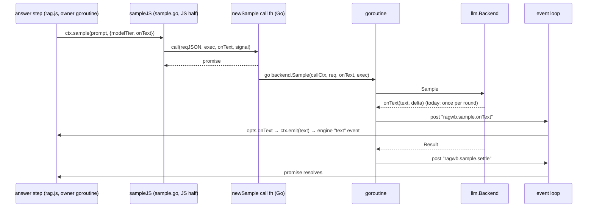
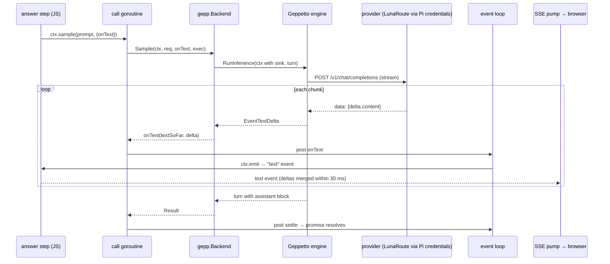

# Intern guide: language-model calls in rag-workbench, and a Geppetto backend with Pi credentials and token streaming

> **Who this is for.** You are new to rag-workbench and possibly to Geppetto and Pi. After reading sections 1–6 you should be able to explain how a language-model call travels from a JavaScript pipeline step to a model provider and back to a browser, and why answer text does not stream today. Sections 7–9 introduce Geppetto and Pi. Sections 10–13 are the design and the implementation plan for this ticket. Sections 14–15 are reference material.

## 1. Executive summary

rag-workbench runs retrieval pipelines written in JavaScript on a Go runtime. Several pipeline steps call a language model: an LLM reranker, a query rewriter, an answer step, an agentic step with tools, and the workbench's chat agent. All of them call one function, `sample()`, whose contract was inherited from the claude.ai artifact runtime where the project began. On the Go side, `sample()` is served by a `llm.Backend`, and today the only real backend is a hand-written OpenAI-compatible client for one gateway, LunaRoute.

That client does not stream. It sends each chat completion without `"stream": true`, waits for the complete reply, and reports the text once per tool-loop round. Everything downstream of the backend — the JavaScript bridge, the engine's `text` events, the Server-Sent Events (SSE) transport and the browser shell — already handles incremental text. The missing piece is a backend that produces it.

This ticket adds a second backend built on **Geppetto**, the go-go-golems LLM library, configured from **Pi's agent directory** (`~/.pi/agent`): Pi's model catalog, its stored credentials (API keys and OAuth tokens, refreshed automatically) and its settings. slop-computer already uses exactly this combination. The new backend streams token deltas through the existing path, runs the same tool loop, and makes every model Pi is logged in to usable from rag-workbench — LunaRoute, OpenAI Codex, Anthropic and others — selected with references such as `lunaroute/glm-5.3-flash` or `openai-codex/gpt-5.6-luna:low`.

A spike (section 9) confirms the approach: through Geppetto, `lunaroute/glm-5.3-flash` delivered a 112-token answer as 43 text deltas, the first after 402 ms of a 1.76 s call.

## 2. Problem statement and scope

### 2.1 Problems

1. **No token streaming.** Answers in the served app and in `POST …/verbs/ask` with `Accept: text/event-stream` appear all at once at the end of each model round. For a 5–20 s answer the user sees nothing until it is complete.
2. **One provider, one credential source.** The client speaks one gateway, reads a static key from `$LUNAROUTE_API_KEY` or `~/.pi/agent/models.json`, and cannot use the OAuth credential Pi keeps for the same gateway, nor any other provider.
3. **A second copy of shared logic.** Tool loops, error classification, thinking-level handling and provider quirks are maintained in Geppetto and its Pi provider for other projects (slop-computer, pinocchio). rag-workbench reimplements a subset.

### 2.2 Goals

- A `llm.Backend` implementation on Geppetto with Pi's agent directory, selected with `--llm pi`.
- Token-level streaming: every text delta reaches `onText`, and therefore the engine's `text` events, SSE clients and the UI.
- Behavior parity with the current client where it matters: tiers (`quick`, `default`, `complex`), the tool loop with a forced final answer, output budgets per tier, failure codes, cancellation.
- Unit tests against a scripted provider (no network), plus a live check.

### 2.3 Non-goals

- Embeddings and cross-encoder reranking (`index.vector`, `rerank.model`). Pi's catalog has no embedding or rerank models, and these keep using the direct LunaRoute client (`--embed lunaroute`).
- Changing the `sample()` contract, the JavaScript steps, the event model or the SSE transport.
- Removing `--llm lunaroute`. It stays as a non-streaming fallback.

## 3. Orientation: rag-workbench in one page

rag-workbench (`ragwb`) is a Go program that embeds a JavaScript engine, `rag.js`, and runs it on **goja**, a JavaScript interpreter written in Go. A user writes a *corpus* (how files become chunks and indexes) and a *plan* (how a query is answered) with a fluent API:

```js
const plan = rag.plan("answer").over(corpus)
  .signals({ q: "", k: 8, filters: {} })
  .retrieve("text", { k: 30 })
  .retrieve("meta", { k: 20 })
  .fuse.rrf({ k: 60 })
  .filter.where({ field: "filters" })
  .rerank.llm({ top: 20, keep: s => s.k })   // calls the model (submit-trigger)
  .pack({ budget: 30000 })
  .answer();                                 // calls the model (submit-trigger)
```

Each method adds a **component** (a step) to a graph. **Build** components (parse, chunk, index) run once per corpus version; **live** components run per query. A live component declares a **trigger**: `change` steps run on every keystroke, `submit` steps only when the user presses Enter. Every step that calls a language model is a `submit` step, so typing never spends model calls.

Three things about the runtime matter for this ticket:

- **One JavaScript thread per runtime.** A `goja.Runtime` must be used by one goroutine at a time. go-go-goja wraps it with an *owner* goroutine and an *event loop*; code on other goroutines reaches JavaScript only by posting a callback to the loop (`runtimebridge.PostWithLifetimeContext`).
- **Long Go work returns a promise.** A Go function called from JavaScript that takes time (a model call) creates a promise, does the work on a goroutine, and posts progress callbacks and the final resolve/reject back to the loop.
- **Three surfaces.** The same plans run as command-line verbs (`ragwb verbs`, `ragwb run`), as a served app whose engine runs on the server (`ragwb serve`, with verb endpoints that stream events over SSE), and in the browser workbench (`ragwb workbench`), where the engine runs in the page and the Go server provides `window.claude.sample` over SSE.

## 4. Where language models are called

| caller | file | what it asks | tier | tools |
|---|---|---|---|---|
| `rewrite.llm` | `pkg/ragjs/assets/rag.js` | 2–6-word keyword queries, JSON | `quick` (default) | no |
| `rerank.llm` | `rag.js` | rank 20 passages, JSON `{ranking:[…]}` | `quick` | no |
| `answer` | `rag.js:748-759` | an answer from packed evidence, citing `[E1]` | `default` | no |
| `agentic` | `rag.js:760-813` | an answer after `search`/`read`/`outline`/`documents` calls | `default` | yes |
| `enrich.llm` (build) | `rag.js:537-547` | summary/questions/keywords per chunk, JSON | `quick` | no |
| evals `generate`/judges | `rag.js` (Evals) | questions for sampled sections; graded judgments | varies | no |
| HyDE preset | `examples/presets/hyde.js` | a hypothetical answer as a query | `quick` | no |
| workbench agent | `web/workbench/agent.js` via `/_rt/sample` | chat turns; runs `eval(code)` in the page | user-chosen | `eval` |

The `answer` and `agentic` steps pass `onText`, so they are the ones whose text should stream. JSON steps (`sample.json`) do not display partial text; for them streaming only changes latency to first byte.

## 5. The `sample()` contract (API reference)

Every caller uses the claude.ai artifact contract, implemented in `pkg/ragjs/sample.go` for scripts and in `web/workbench/claude.js` + `pkg/server/sample.go` for the page.

```ts
sample(input: string | Array<{role: 'user'|'assistant', content: string}>, opts?: {
  modelTier?: 'quick' | 'default' | 'complex',   // default 'default'
  model?: string,                                // explicit model (overrides the tier)
  tools?: Array<{ name, description, inputSchema, execute(input, {signal}) }>,
  onText?: ({ text, delta }) => void,            // text = whole answer so far, delta = new part
  signal?: AbortSignal,
}): Promise<{ text: string, truncated: boolean, modelTierApplied: string, modelApplied?: string }>

sample.json(input, opts): Promise<any>           // the reply parsed tolerantly as JSON
sample.limits(): Promise<{ tools: { maxCount: 16 } }>
// rejections: { code, message, text? }, e.g. invalid_request, cancelled, invalid_json,
//             rate_limited, not_granted, upstream_error, empty_completion, prompt_too_large
```

In Go, the contract becomes one interface (`pkg/llm/llm.go`):

```go
type Backend interface {
    Sample(ctx context.Context, req Request, onText OnText, exec ExecuteTool) (Result, error)
}
type Request struct {
    Turns     []Turn   // {Role: "user"|"assistant", Content}
    Tier      string   // quick | default | complex ("" = default)
    Model     string   // explicit model, overrides the tier
    Tools     []Tool   // {Name, Description, InputSchema json.RawMessage}
    MaxTokens int
    JSON      bool     // the caller will parse the final text as JSON
}
type Result struct { Text string; Truncated bool; TierApplied, ModelApplied string; Rounds int; Usage Usage }
type OnText func(text, delta string)                                   // whole text so far, new part
type ExecuteTool func(ctx context.Context, call ToolCall) (ToolResult, error) // ToolCall{ID, Name, Input}
type Failure struct { Code, Message, Text string }                     // the SampleError shape
```

Two properties of this interface shape the design:

- **The backend owns the tool loop.** It asks the model, executes requested tools through `exec`, appends the results, and asks again, until the model answers without tools. `exec` runs the JavaScript tool (it is posted to the event loop by the caller); the backend never sees JavaScript.
- **`onText` takes the whole text so far plus the delta.** Consumers may use either. The engine's `ctx.emit` takes the whole text and derives deltas itself, emitting `reset: true` when a new text does not extend the previous one. A backend may therefore *correct* earlier text (for example, remove leaked tool markup) by calling `onText` with a text that is not an extension.

JSON mode (`Request.JSON`) is not sent to the provider. Callers parse the final text with `llm.ParseJSON` (whole reply, else the first code fence, else the outermost `{…}`/`[…]` span) and reject with `invalid_json` on failure. A backend does not need to know about JSON.

## 6. The current call path, end to end

### 6.1 Script steps (`ragwb run`, `verbs`, `serve`)



Step by step, with file references:

1. `rag.js:755` — the `answer` step calls `ctx.sample(prompt, { modelTier, onText: ({text}) => ctx.emit(text) })`.
2. `pkg/ragjs/sample.go:18-52` — the JavaScript half normalizes the input to turns, wraps each tool's `execute` so that errors become tool results (`{value, isError: true}`), and calls the Go function `call(JSON.stringify(req), exec, onText, signal)`.
3. `pkg/ragjs/sample.go:67-191` — the Go half creates a promise, derives `callCtx` from the runtime lifetime, cancels it when the JavaScript `AbortSignal` fires, and runs `backend.Sample` **on a goroutine**. `onText` and tool executions are posted to the event loop (`ragwb.sample.onText`, `ragwb.sample.tool`); the settlement is posted last (`ragwb.sample.settle`), so it always runs after every text callback.
4. `rag.js:1935-1960` — `ctx.emit(text)` keeps the last text, calls the run's `onText(node, text)` and emits `{type: 'text', node, delta}` (or `reset: true`) into the request's event scope.
5. `pkg/server/sse.go` — under `ragwb serve`, the pump writes events as SSE and merges text deltas of one node that arrive within 30 ms (`sseCoalesce`) into one `text` event.
6. `web/app-shell/shell.js` — the browser shell accumulates deltas per node and calls the UI runtime's `onText(node, textSoFar)`, which repaints the answer at most every 60 ms.

### 6.2 The workbench page

`web/workbench/claude.js` implements `window.claude.use('sample')` as a client of `POST /_rt/sample`, an SSE endpoint in `pkg/server/sample.go`. The handler builds an `llm.Request`, emits `call`, then `text` events from the backend's `onText` (`sample.go:129`), `tool` events that the page executes and answers with `POST /_rt/sample/{call}/tools/{use}`, and finally `result` or `error`. The same backend instance serves it.

### 6.3 Where the backend is chosen

Every command obtains its backend from one function, `cmds.LLM()` (`cmd/ragwb/cmds/roots.go:49`), called by `run`, `verbs`, `serve` and `workbench`. `--llm none|fake|lunaroute` selects it; `--llm-quick/--llm-default/--llm-complex` set the tier models; `--llm-max-rounds` bounds the tool loop.

## 7. Why answers do not stream today

The LunaRoute client (`pkg/llm/lunaroute.go:209-300`) runs the tool loop with one non-streaming request per round:

```go
body := map[string]any{"model": model, "messages": msgs, "max_tokens": maxTokens}   // no "stream": true
if len(tools) > 0 && !lastRound { body["tools"] = tools }
var r oaResponse
if err := c.post(ctx, "/v1/chat/completions", body, &r); err != nil { … }
content := stripToolMarkup(ch.Message.Content)
if content != "" {
    delta := content
    if all.Len() > 0 { delta = "\n\n" + delta }       // rounds are separated by a blank line
    all.WriteString(delta)
    if onText != nil { onText(all.String(), delta) }  // once per round, with the whole round's text
}
```

For an answer without tools that is one `onText` call with the complete text. The pipeline described in section 6 faithfully forwards that one call. Streaming with `--llm fake` works only because the fake backend splits its reply into pieces on purpose (`RAGWB_FAKE_STREAM`).

The client also contains behavior the new backend must preserve:

| behavior | where | why |
|---|---|---|
| tier → model: quick `muse-spark-open`, default `glm-5.3-flash`, complex `glm-5.3` | `lunaroute.go:25-27` | defaults chosen in RAGWB-001 by latency probes |
| output budget per round: quick 2,048, default 8,192, complex 16,384 tokens | `lunaroute.go:45` | GLM models reason, and reasoning spends the output budget |
| at most 10 rounds; the last round offers no tools and adds a user message forcing an answer | `lunaroute.go:29-31, 241-247` | without it GLM prints its native tool-call syntax as text |
| `stripToolMarkup` removes `<tool_call>`, `<\|tool_call\|>`, `<function_call>` and everything after | `lunaroute.go:35-42` | same reason |
| rounds joined with a blank line | `lunaroute.go:268-271` | the `sample` spec |
| failure codes: 429 → `rate_limited`, 400/404/422 → `invalid_request`, 401/403 → `not_granted`, else `upstream_error`; empty text → `empty_completion` | `lunaroute.go:120-140, 280-290` | the `sample` spec |

## 8. Concepts: Pi's agent directory and Geppetto

### 8.1 Pi's agent directory

**Pi** is the coding agent used on this machine. It keeps its configuration in an *agent directory*, `~/.pi/agent` (or `$PI_CODING_AGENT_DIR`). Geppetto's Pi provider reads four files from it:

| file | content | used for |
|---|---|---|
| `settings.json` | `defaultProvider`, `defaultModel`, `defaultThinkingLevel`, `enabledModels` | default model and thinking level |
| `models-store.json` | the catalog Pi refreshed from providers: `{provider: {models: [{id, api, reasoning, maxTokens, input, compat, …}]}}` | which models exist and how to talk to them |
| `models.json` | user-defined providers: `{providers: {id: {baseUrl, api, apiKey, headers, compat, models}}}` | base URLs, extra models, static API keys |
| `auth.json` | one credential per provider: `{type: "api_key", key}` or `{type: "oauth", access, refresh, expires}` | credentials |

A model is named by a **reference** `provider/id`, for example `lunaroute/glm-5.3-flash`. Each catalog entry has an `api` field naming its wire protocol: `openai-completions`, `openai-responses`, `openai-codex-responses`, `anthropic-messages` or `google-generative-ai`. A **thinking level** (`off`, `minimal`, `low`, `medium`, `high`, `xhigh`) controls reasoning; Geppetto maps it to each protocol's knobs (`reasoning_effort`, `thinking.type`, Anthropic thinking budgets).

On this machine (structure only; no secrets are printed in this ticket): settings default to `openai-codex/gpt-5.6-luna` with thinking `minimal`; `auth.json` holds credentials for anthropic, zai, minimax, fireworks, kimi-coding, umans, lunaroute (OAuth) and openai-codex (OAuth); the catalog contains `lunaroute/muse-spark-open`, `lunaroute/glm-5.3-flash` and `lunaroute/glm-5.3` (all `openai-completions`, reasoning models), and 43 models are *available* (supported protocol and a credential present).

Credentials never leave Geppetto's engines as plain configuration. An engine receives a `BearerTokenSource` and asks it for a token per request. For an OAuth credential, the source refreshes an expired token and writes the new one back to `auth.json` under Pi's own file lock, so rag-workbench and a running Pi share the credential safely.

### 8.2 Geppetto in five types

Geppetto separates the conversation, the provider call, and the observation of the call.

- **`turns.Turn`** — the conversation, as a list of **blocks**: user text (`turns.NewUserTextBlock`), assistant text (`NewAssistantTextBlock`), tool calls the model made, and tool results (`NewToolUseBlock(id, result)`, `NewToolUseBlockWithError(id, result, err)`). `turns.AppendBlock(t, b)` appends. Per-turn settings live in `t.Data` under typed keys, for example `engine.KeyInferenceConfig`.
- **`engine.Engine`** — one method, `RunInference(ctx, t) (*turns.Turn, error)`: send the turn to the provider and return it with the model's blocks appended. An engine performs **one** provider call; it does not run tools ("tool calls in the response should be preserved as blocks for helper processing").
- **Events and sinks** — while an engine runs, it publishes events to every sink attached to the context with `events.WithEventSinks(ctx, sink)`. A sink implements `PublishEvent(events.Event) error`. The events used here are `*events.EventTextDelta` (`Delta`), `*events.EventReasoningDelta`, `*events.EventProviderCallFinished` (`StopReason`, `Usage`) and `*events.EventError`.
- **Tools** — a `tools.ToolRegistry` (`tools.NewInMemoryToolRegistry()`, `RegisterTool(name, tools.ToolDefinition{Name, Description, Parameters *jsonschema.Schema})`) attached with `tools.WithRegistry(ctx, reg)` makes the engine offer those tools. After `RunInference`, `toolblocks.ExtractPendingToolCalls(t)` returns the calls without results: `[]toolblocks.ToolCall{ID, Name, Arguments map[string]any}`.
- **`engine.InferenceConfig`** — per-call knobs (`MaxResponseTokens`, `ReasoningEffort`, `ThinkingType`, `ThinkingBudget`, …). A config set on the turn is merged *field by field* over the engine's defaults (`engine.MergeInferenceConfig`), so setting only `MaxResponseTokens` on the turn keeps the thinking settings the Pi provider resolved.

### 8.3 The Pi provider

`github.com/go-go-golems/geppetto/pkg/steps/ai/providers/pi`:

```go
dir, err := pi.LoadAgentDir(pi.DefaultDir(os.Getenv(pi.EnvAgentDir)), opts...)  // reads the four files
models := dir.Available()                       // supported protocol + credential present
res, err := dir.Resolve(ctx, "lunaroute/glm-5.3-flash", pi.ResolveOptions{Thinking: "off"})
eng, err := res.Engine()                        // cheap: create one per call
out, err := eng.RunInference(events.WithEventSinks(ctx, sink), turn)
```

`Resolve` looks the reference up in the catalog, rejects unsupported protocols (`*pi.UnsupportedAPIError`), builds inference settings without secrets, maps the thinking level, sets the model's `maxTokens` as the default output limit, and prepares a credential source; a provider without a credential gives `*pi.NoCredentialError`. Options used by tests: `pi.WithLocalProviders()` (allow `http://127.0.0.1` base URLs), `pi.WithEnv(lookup)`; `pi.WithProviderHeaders(provider, headers)` adds request headers (slop-computer sends LunaRoute's agent and session headers this way).

### 8.4 How slop-computer uses it

slop-computer's `pkg/llm/gepp` (backend.go 182 lines, sample.go 455 lines) is the reference implementation. Its backend loads the agent directory once, picks a model per tier (an explicit `provider/model[:level]` reference, else Pi's default model if it is enabled and available, else the first enabled available model), and runs each `sample` call as rounds of one `RunInference` each, with a sink that turns `EventTextDelta` into its own `text` events, tool calls executed between rounds, an output budget shared across rounds, and error classification into contract codes. Its interface differs from ours (events instead of `onText`/`Result`, images, a metering hook), so the design below ports the logic, not the package.

## 9. Spike results

`scripts/01-geppetto-pi-spike/main.go` loads the real agent directory, resolves a model and runs one inference with a counting sink. Results on 2026-11-04:

| model | thinking | text deltas | first delta | total | reasoning deltas | output tokens |
|---|---|---|---|---|---|---|
| `lunaroute/glm-5.3-flash` | off | 43 | 402 ms | 1.756 s | 0 | 112 |
| `lunaroute/muse-spark-open` | off | 13 | 1.348 s | 1.496 s | 81 | 474 |
| `lunaroute/glm-5.3-flash` | minimal | 44 | 335 ms | 1.811 s | 0 | 120 |

Loading the agent directory took 2 ms and found 43 available models. Two conclusions: streaming works with Pi's stored LunaRoute credential, and `muse-spark-open` reasons even at `off` (474 output tokens for an 80-word answer), so the `quick` tier's output budget must stay generous enough for reasoning plus a JSON reply.

Adding the dependency (`go get github.com/go-go-golems/geppetto@v0.13.13`) raised the `go` directive to 1.26.6 and upgraded glazed from v1.3.5 to v1.4.3. go-go-goja stays at v0.10.7 and goja at `97b96e1` (the Unicode canary test passes). glazed v1.4 renamed the output flags of every verb: `--output` became `--format` (`table, json, jsonl, csv, tsv, yaml`) and `--fields` became `--output-fields`. One test used the old flag.

## 10. Design

### 10.1 Package and types

A new package `pkg/llm/gepp` implements `llm.Backend`:

```go
package gepp

type Config struct {
    AgentDir  string         // "" = pi.DefaultDir($PI_CODING_AGENT_DIR)
    Tiers     llm.TierModels // provider/model[:level] per tier; "" = Pi's default model
    MaxRounds int            // 0 = llm.DefaultMaxRounds (10)
    Options   []pi.Option    // tests: pi.WithLocalProviders()
}

type Backend struct {
    dir       *pi.AgentDir
    tiers     map[string]choice // quick, default, complex → resolved model + thinking level
    baseline  string            // settings.json defaultThinkingLevel ("" when off)
    maxRounds int
}
type choice struct { model pi.Model; level string }

func New(cfg Config) (*Backend, error)
func (b *Backend) Sample(ctx context.Context, req llm.Request, onText llm.OnText, exec llm.ExecuteTool) (llm.Result, error)
func (b *Backend) Describe() string   // "pi: quick=lunaroute/muse-spark-open default=… complex=…" for startup lines
```

### 10.2 Choosing models

The `--llm-quick/--llm-default/--llm-complex` flags keep their meaning but take Pi references under `--llm pi`. Resolution of one reference, following slop-computer:

```text
lookup(ref):
  if ref ends in ":<level>" with level ∈ {off, minimal, low, medium, high, xhigh}: split it off
  if ref is an available "provider/id": use it
  if ref has no "/" and exactly one available model has that id: use it
  otherwise: error "no authenticated Pi model %q for tier %s"
```

Defaults under `--llm pi` are the current models with an explicit provider: `lunaroute/muse-spark-open`, `lunaroute/glm-5.3-flash`, `lunaroute/glm-5.3`. A bare id such as `glm-5.3` is accepted when unique, which keeps old command lines working; the provider prefix avoids ambiguity when two providers serve a model with the same id. `Request.Model` (an explicit model from `sample(…, {model})`) is resolved the same way and falls back to the tier when unavailable.

The thinking level of a call:

```text
level(choice, tier):
  if the reference named a level: that level
  if tier == "quick": "off"                 // JSON helpers: fast, small
  if settings.json defaultThinkingLevel is set and not "off": that level
  else "off"
```

### 10.3 The sample algorithm

```text
Sample(ctx, req, onText, exec):
  turns := NormalizeTurns(req.Turns)                       // existing validation and merge
  check len(input) <= MaxInputBytes                        // prompt_too_large
  ch := pick(req.Model, req.Tier)                          // section 10.2
  res := dir.Resolve(ctx, ch.model.Ref(), {Thinking: level(ch, tier)})
  t := Turn of turns (user → NewUserTextBlock, assistant → NewAssistantTextBlock)
  reg := registry of req.Tools (JSON schema → *jsonschema.Schema; none → empty object)
  perRound := req.MaxTokens || tierBudget[tier]            // 2048 / 8192 / 16384
  text := ""                                               // across rounds
  for round := 1 .. maxRounds:
      last := round == maxRounds
      if last && round > 1 && tools: append user block "(The tool budget … Answer now …)"
      set KeyInferenceConfig{MaxResponseTokens: perRound} on t
      rctx := ctx; if tools && !last: rctx = tools.WithRegistry(ctx, reg)
      s := sink{round, onText, &text}                       // streams deltas, section 10.4
      t, err = res.Engine().RunInference(events.WithEventSinks(rctx, s), t)
      if ctx.Err(): return ctx.Err()                        // cancelled
      if err or s.failed: return classify(err)              // section 10.6
      accumulate usage, truncated = stop reason ∈ {length, max_tokens, …}
      calls := toolblocks.ExtractPendingToolCalls(t)
      if len(calls) == 0 || last || exec == nil: break
      for each call in order:                               // sequential: tools run on one JS thread
          input := json.Marshal(call.Arguments) (or "{}")
          r, err := exec(ctx, llm.ToolCall{ID, Name, Input: input})
          if err: return err
          append NewToolUseBlock(id, resultText(r.Value)) or NewToolUseBlockWithError(id, text, text)
  clean := stripToolMarkup(text)
  if clean != text: onText(clean, "")                       // a correction: ctx.emit sends reset
  if strings.TrimSpace(clean) == "": return empty_completion
  return Result{Text: clean, Truncated, TierApplied: tier, ModelApplied: ref, Rounds, Usage}
```

Tools are executed sequentially in call order. slop-computer runs them in parallel because its tools run in browser pages; here `exec` posts every call to the same JavaScript event loop, so parallel execution would only interleave them at `await` points and make tool order nondeterministic.

### 10.4 Streaming

The sink is where streaming happens. Geppetto calls `PublishEvent` from the goroutine running `RunInference`, which is the goroutine `pkg/ragjs/sample.go` started for the call, so `onText` may be called directly; the caller already posts it to the event loop (scripts) or writes it to the SSE response (workbench).

```go
func (s *sink) PublishEvent(e events.Event) error {
    switch e := e.(type) {
    case *events.EventTextDelta:
        if e.Delta == "" { return nil }
        d := e.Delta
        if !s.started && *s.text != "" { d = "\n\n" + d }   // a new round after earlier text
        s.started = true
        *s.text += d
        if s.onText != nil { s.onText(*s.text, d) }
    case *events.EventProviderCallFinished:
        s.stop = e.StopReason; s.usage = e.Usage
    case *events.EventError:
        if s.failed == nil { s.failed = errors.New(e.ErrorString) }
    }
    return nil
}
```

Reasoning deltas are not forwarded: the `sample` contract has no thinking channel, and reasoning text must not appear in answers. The downstream pipeline needs no change: the engine already turns `onText` into `text` events with deltas, the SSE pump already merges deltas within 30 ms, and the shell already repaints at most every 60 ms. The number of event-loop posts per answer equals the number of provider deltas (tens to a few hundred), which the loop handles without measurable cost.

### 10.5 The flow after the change



### 10.6 Errors and cancellation

| condition | code | message |
|---|---|---|
| `*pi.NoCredentialError`, 401/403, "unauthorized", invalid or expired key/token | `not_granted` | "no Pi credential for this provider (log in with pi)" plus the provider |
| unknown reference, no available model for a tier | (startup error) | names the tier and reference |
| `*pi.UnsupportedAPIError` | `invalid_request` | names the model and its API |
| 429, "rate limit", "too many requests" | `rate_limited` | fixed text |
| 413, context length, "prompt is too long" | `prompt_too_large` | fixed text |
| 400/404/422 | `invalid_request` | fixed text |
| empty final text | `empty_completion` | "model produced no answer text" (+ " (max_tokens spent on reasoning)" when truncated) |
| anything else | `upstream_error` | fixed text, provider message appended after a redaction pass |

Provider error bodies can quote request content, and must never contain credentials; the classifier keeps messages short and never formats headers. Every failure carries `Text`: the answer text produced before it failed.

Cancellation needs no new mechanism. `pkg/ragjs/sample.go` cancels `callCtx` when the JavaScript `AbortSignal` fires (request scope aborted, client disconnected); Geppetto's HTTP request uses that context; `Sample` returns `ctx.Err()`, and the caller maps it to `{code: 'cancelled'}`.

### 10.7 Command line and wiring

`cmds.LLM()` gains a case:

```go
case "pi":
    b, err := gepp.New(gepp.Config{AgentDir: piAgentDir, Tiers: piTiers(), MaxRounds: maxRounds})
```

- `--llm pi` selects the backend. Help: "pi (Geppetto with Pi's models and credentials, streams tokens; recommended)".
- `--pi-agent-dir` (default `$PI_CODING_AGENT_DIR` or `~/.pi/agent`).
- Tier flags: when the user did not set a tier flag, the Pi defaults (`lunaroute/…`) apply under `--llm pi` and the bare ids under `--llm lunaroute`.
- Startup lines that print the backend (`ragwb workbench on … (llm: …)`) show the resolved tier models.

`--embed lunaroute` and the embedding cache are unchanged.

### 10.8 Decisions

- **D1: Port, don't import slop-computer.** slop's `gepp` is written against slop's own `llm` interface (events, images, metering). Copying about 300 lines of logic adapted to rag-workbench's interface is simpler than an adapter between two event models; the two implementations share Geppetto and the Pi provider, which is where the provider logic lives.
- **D2: Keep `--llm lunaroute`.** It is the fallback when Pi is not installed and is still the embeddings client. `--llm pi` is documented as the recommended backend.
- **D3: Same tiers and budgets as today.** Users see the same models by default; only the transport changes. Changing defaults (for example to Pi's default model) is a separate decision.
- **D4: Sequential tools.** See section 10.3.
- **D5: Correct, don't filter, leaked tool markup.** Deltas are streamed as they arrive; if the final text contains tool-call markup, one corrective `onText` with the cleaned text follows, which the engine turns into a `reset` text event. Filtering markup out of a stream would require buffering every delta that could start a marker.
- **D6: Accept the glazed v1.4 flag rename.** Geppetto v0.13.13 requires it; the rename is recorded in help, docs and the changelog.

## 11. Testing strategy

**Unit tests (`pkg/llm/gepp`), no network.** A scripted OpenAI Chat Completions server (`httptest`) returns SSE chunks; a temporary agent directory points a `lunaroute` provider at it with a test API key and two models; `pi.WithLocalProviders()` allows the local URL. Cases:

1. Streaming: three content chunks → three `onText` calls with growing text, `Result.Text` equal to their concatenation, usage summed.
2. Tool loop: round 1 returns a tool call; `exec` is called with the right id, name and JSON input; round 2 answers; the second request contains the tool result; rounds joined with a blank line.
3. Forced final round: with `MaxRounds: 2` and a model that always calls tools, the second request offers no tools and contains the forcing message.
4. Tier resolution: `provider/id`, `id` (unique), `provider/id:level`, unknown reference → error; `Request.Model` overrides the tier.
5. Thinking level: the quick tier sends no reasoning effort; an explicit `:high` does.
6. Output budget: the request's `max_tokens`/`max_completion_tokens` equals the tier budget.
7. Errors: 401 → `not_granted`, 429 → `rate_limited`, empty answer → `empty_completion`.
8. Cancellation: cancelling the context during a slow stream returns `context.Canceled` promptly.
9. Leaked markup: a final text containing `<tool_call>` → a corrective `onText` and a cleaned `Result.Text`.

**Integration.** In `pkg/ragjs`, run the `answer` plan inside a request scope with the gepp backend pointed at the scripted server; the folded `text` events must be more than one and concatenate to the final answer. In `pkg/server`, the SSE verb endpoint with the same backend must deliver several `text` events.

**Live check.** `ragwb --llm pi serve` the answer-first preset; `curl -N` the reports `ask` verb with `Accept: text/event-stream` and count `text` events; observe the answer growing in the browser's Answer tab.

## 12. Implementation plan

| phase | work | files |
|---|---|---|
| 0 | dependency (done in the spike), glazed flag rename in tests and help | `go.mod`, `go.sum`, `cmd/ragwb/cmds/verbs_test.go` |
| 1 | `pkg/llm/gepp`: `New`, tier lookup, thinking policy, `Sample`, sink, classifier; unit tests | `pkg/llm/gepp/backend.go`, `sample.go`, `gepp_test.go` |
| 2 | CLI: `--llm pi`, `--pi-agent-dir`, tier defaults, startup descriptions | `cmd/ragwb/cmds/roots.go`, `workbench.go`, `serve.go` |
| 3 | integration tests (ragjs events, SSE) and the live check | `pkg/ragjs/*_test.go`, `pkg/server/*_test.go` |
| 4 | docs: guide status, diary, changelog, vault note | ticket, go-go-parc |

## 13. Risks and open questions

- **Reasoning budget.** `muse-spark-open` reasons at `off`; reasoning output counts against `max_tokens`. If JSON steps start failing with `invalid_json` on truncated replies, raise the quick budget or choose a non-reasoning quick model.
- **Event-loop load.** One post per delta. A 2,000-token answer streamed in small chunks posts hundreds of callbacks; each is a short JavaScript call. If this shows up in profiles, merge deltas in Go for 10–20 ms before posting.
- **OAuth refresh writes `auth.json`.** Geppetto writes refreshed tokens under Pi's lock. rag-workbench must never print or copy that file; tests use temporary directories with fake keys.
- **Provider differences.** Pi's catalog spans five wire protocols. Tool calling and reasoning differ by protocol; the unit tests cover OpenAI completions only. Other providers are exercised only by live use.
- **glazed v1.4.** Other flags may have changed (`--fields` → `--output-fields`); scripts and documentation that pass output flags to verbs must be updated.

## 14. API reference

### rag-workbench

| symbol | file | role |
|---|---|---|
| `llm.Backend`, `Request`, `Result`, `OnText`, `ExecuteTool`, `ToolCall`, `ToolResult`, `Failure` | `pkg/llm/llm.go` | the backend interface |
| `llm.NormalizeTurns`, `llm.MaxInputBytes`, `llm.ParseJSON` | `pkg/llm/llm.go` | input validation, tolerant JSON |
| `llm.Client.Sample`, `DefaultTiers`, `DefaultMaxRounds`, `stripToolMarkup`, `tierBudget` | `pkg/llm/lunaroute.go` | the current backend |
| `llm.Fake` | `pkg/llm/fake.go` | deterministic backend, `RAGWB_FAKE_STREAM` |
| `sampleJS`, `newSample` | `pkg/ragjs/sample.go` | the JavaScript `sample` and its Go half |
| `ctx.emit`, `hitsEvent`, `newScope`, `scoped` | `pkg/ragjs/assets/rag.js` | text events and request scopes |
| `handleSample` | `pkg/server/sample.go` | `/_rt/sample` SSE for the workbench |
| `sseWriter.pump`, `sseCoalesce` | `pkg/server/sse.go` | delta merging on SSE |
| `cmds.LLM`, `AddGlobalFlags` | `cmd/ragwb/cmds/roots.go` | backend selection |

### Geppetto v0.13.13

| symbol | package | role |
|---|---|---|
| `pi.LoadAgentDir(dir, opts…)`, `pi.DefaultDir(env)`, `pi.EnvAgentDir` | `pkg/steps/ai/providers/pi` | load Pi's files |
| `(*AgentDir).Available() []Model`, `Resolve(ctx, ref, ResolveOptions{Thinking, MaxTokens})` | same | models with credentials; an engine factory |
| `pi.Model{Provider, ID, API, Reasoning, MaxTokens, …}.Ref()` | same | catalog entry |
| `*pi.NoCredentialError`, `*pi.UnsupportedAPIError`, `pi.ErrUnknownModel` | same | resolution errors |
| `pi.WithLocalProviders()`, `pi.WithEnv`, `pi.WithProviderHeaders` | same | options |
| `engine.Engine.RunInference(ctx, *turns.Turn)` | `pkg/inference/engine` | one provider call |
| `engine.KeyInferenceConfig`, `engine.InferenceConfig{MaxResponseTokens, …}` | same | per-turn settings, merged per field |
| `turns.Turn`, `AppendBlock`, `NewUserTextBlock`, `NewAssistantTextBlock`, `NewToolUseBlock`, `NewToolUseBlockWithError` | `pkg/turns` | conversation |
| `toolblocks.ExtractPendingToolCalls(t) []ToolCall{ID, Name, Arguments}` | `pkg/turns/toolblocks` | tool calls to run |
| `tools.NewInMemoryToolRegistry`, `RegisterTool`, `ToolDefinition{Name, Description, Parameters}`, `tools.WithRegistry` | `pkg/inference/tools` | offering tools |
| `events.WithEventSinks`, `EventTextDelta`, `EventReasoningDelta`, `EventProviderCallFinished{StopReason, Usage}`, `EventError` | `pkg/events` | streaming observation |

## 15. File reference

| path | role in this ticket |
|---|---|
| `/home/manuel/code/wesen/go-go-golems/rag-workbench/pkg/llm/llm.go` | interface the new backend implements |
| `/home/manuel/code/wesen/go-go-golems/rag-workbench/pkg/llm/lunaroute.go` | behavior to preserve (tiers, budgets, rounds, markup, codes) |
| `/home/manuel/code/wesen/go-go-golems/rag-workbench/pkg/llm/gepp/` | new package |
| `/home/manuel/code/wesen/go-go-golems/rag-workbench/pkg/ragjs/sample.go` | caller: goroutine, posts, cancellation |
| `/home/manuel/code/wesen/go-go-golems/rag-workbench/pkg/server/sample.go` | caller: workbench SSE |
| `/home/manuel/code/wesen/go-go-golems/rag-workbench/cmd/ragwb/cmds/roots.go` | flags and backend selection |
| `/home/manuel/code/wesen/go-go-golems/rag-workbench/pkg/ragjs/assets/rag.js` | `answer`, `agentic`, `ctx.emit` |
| `/home/manuel/code/wesen/go-go-golems/rag-workbench/pkg/server/sse.go`, `web/app-shell/shell.js` | downstream streaming |
| `/home/manuel/code/wesen/slop-computer/pkg/llm/gepp/{backend,sample,gepp_test}.go` | reference implementation |
| `/home/manuel/code/wesen/go-go-golems/geppetto/pkg/steps/ai/providers/pi/` | Pi provider (agentdir, resolve, thinking, catalog) |
| `ttmp/2026/11/04/RAGWB-006--…/scripts/01-geppetto-pi-spike/main.go` | the spike |
