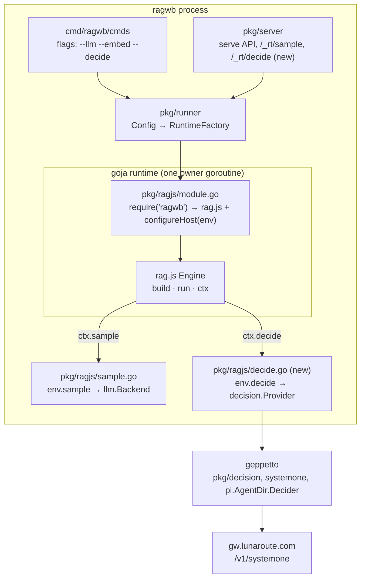

# Decision models in the RAG workbench: analysis, design and implementation

This guide explains how rag-workbench will use decision models to route queries, grade retrieved passages and classify chunks. It assumes you know Go and JavaScript but have not seen this codebase. The guide first explains the parts of the workbench a decision feature touches: the rag.js engine, its plan language, the live run loop, and the Go host that runs it. It then states the design, the pseudocode, the files involved, and the order of implementation.

The decision model itself, and its Geppetto support, is documented in Geppetto's ticket GEPPETTO-DECISION-001 ("Intern guide: decision models in Geppetto"). Read its Part 1 if the words *noul*, *choice* and *score* are new to you. This guide repeats only what is needed.

---

## Part 1 — What we are adding, and why

### 1.1 The gap

A retrieval plan in rag-workbench is a fixed pipeline. A plan such as

```js
rag.plan("answer").over(corpus)
  .signals({ q: "", k: 8 })
  .retrieve("text", { k: 30 })
  .retrieve("meta", { k: 20 })
  .fuse.rrf({ k: 60 })
  .rerank.llm({ top: 20 })
  .pack({ budget: 30000 })
  .answer();
```

runs every step for every query. It cannot skip retrieval for a greeting, choose the dense index for a conceptual question and the keyword index for an error string, or drop passages that a judge says are off-topic. The tools it has for judgment are LLM calls (`rerank.llm`, `rewrite.llm`), which take seconds, return text that must be parsed as JSON, and give no calibrated probability.

### 1.2 What a decision model gives us

A decision model (LunaRoute's `djev`, served on `POST /v1/systemone`) answers typed questions about a state and returns probabilities instead of text:

- a **noul** question returns the probability that a proposition is true ("this passage helps answer the query");
- a **choice** question returns one of the declared options and a distribution over all of them ("keyword, semantic or none");
- a **score** question returns a fractional level on an ordered rubric ("trivial lookup … multi-document synthesis").

All questions in one request share one state, which the model reads once. We measured, with the ticket's spike scripts:

| Request | Questions | Input tokens | Latency |
|---|---|---|---|
| Routing set (choice, noul, score) over one query | 3 | 209–231 | 311–428 ms |
| 12 short passage-relevance nouls | 12 | 659 | 639 ms |
| Report sections, 1 500 characters each | 5 | 2 257 | 1 043 ms |
| Report sections | 10 | 4 580 | 1 301 ms |
| Report sections | 20 | 9 248 | 1 830 ms |
| Report sections | 40 | — | `400 "questions" exceeds this model's max_questions of 32` |

Two facts in that table shape the design. First, grading twenty passages costs less than two seconds and no output tokens worth counting, so grading every query's candidate set is affordable. Second, djev accepts at most **32 questions per request**, a limit the documentation does not state. Every component that grades hits must split its questions into batches of at most 32.

### 1.3 Where this idea comes from

The research literature has named these uses:

- **Adaptive-RAG** (Jeong et al., 2024) trains a small classifier to label each query A (no retrieval), B (single-step retrieval) or C (multi-step retrieval), and routes it accordingly. A `score` or `choice` question is that classifier, with no training.
- **CRAG** (Corrective RAG) grades retrieved documents with a lightweight evaluator and discards or replaces poor ones. A batch of `noul` questions over the hits is that evaluator.
- **Self-RAG** has the generator emit reflection tokens deciding when to retrieve and whether passages are relevant. We get the same judgments from a separate, faster model.
- **Routing and gating** in production systems: choosing an index or a model before an expensive call, and sending uncertain cases to a slower path. `decision.Gate(p, act, confirm)` in Geppetto encodes the threshold pattern.

### 1.4 The features, in one table

| Feature | Kind | What it does |
|---|---|---|
| `ctx.decide(request)` and helpers | JS API | Ask any decision question from any component or lambda |
| `rag.decide(request)` | JS API | The same, for scripts outside a plan run |
| `classify({questions, state?})` | live component | Ask a question set about the query; output a *decision* value |
| `when` (any live node) | node option | Run the node only if a decision (or a lambda) says so |
| `filter.decide({…})` | live component | Grade hits with noul questions and keep those above a threshold |
| `rerank.decide({…})` | live component | Grade hits and reorder by probability |
| `enrich.decide(name, {questions})` | build component | Ask questions about every chunk; store answers as chunk fields |
| `answer({direct: true})` | option | Answer without evidence when retrieval was skipped |
| `--decide`, `--decide-model` | CLI | Choose the decision backend: none, pi, lunaroute, fake |
| `POST /_rt/decide` | HTTP | Give the browser workbench a decision backend |

---

## Part 2 — The parts of rag-workbench you need to know

### 2.1 Processes and layers

rag-workbench (`cmd/ragwb`) is a Go binary that runs a JavaScript retrieval engine, `rag.js`, inside goja (a JavaScript interpreter written in Go). The same `rag.js` also runs in the browser workbench. The Go side provides fast native components (Markdown parsing, BM25 over bleve, vectors), persistence, LLM calls and HTTP servers.



The rule that governs everything on the Go side: **a goja runtime may only be touched from its owner goroutine.** A model call cannot block that goroutine, because the event loop also delivers streamed text, tool calls and other requests. `sample.go` therefore runs `backend.Sample` on its own goroutine and settles the JavaScript promise back on the owner through `runtimebridge`'s `PostWithLifetimeContext`. `decide.go` follows the same pattern.

### 2.2 Components and the registry

`rag.js` (`pkg/ragjs/assets/rag.js`) defines components with two helpers, `build(type, def)` for indexing-time components and `live(type, def)` for query-time ones. A definition is a plain object:

| Field | Meaning |
|---|---|
| `in`, `out` | Port types, e.g. `in: ['hits'], out: 'hits'`. Types: `files`, `docs`, `chunks`, `index`, `value`, `queries`, `hits`, `context`, `answer`. |
| `args` | Turns builder arguments into params `p` (`optArgs` = one options object). |
| `run(s, ctx, input, p)` | Live components: compute the output. `s` is the signals (`s.q`, `s.k`). |
| `map(item, ctx, p, node)` | Build components: map one chunk (with `async: true`, up to `p.concurrency ?? 3` at once). |
| `trigger` | `'change'` (runs as the user types) or `'submit'` (only on an explicit run). |
| `skip` | What a skipped node outputs: `'pass'` (its input) or `'null'`. |
| `reads(p)` | Signals the node depends on, for memoization. |
| `llm` | Build components: the node costs model calls, so it is deferred unless build calls are enabled. |
| `describe(p)` | One-line label for the GUI. |

`rerank.llm`, the closest existing relative of the new components, is a 20-line `live` definition that formats the top hits into a prompt, calls `ctx.sample.json`, and maps the returned ranking back to hits.

### 2.3 Plans, cursors and the IR

The plan builder (`class PlanSpec`) is immutable: each call returns a new spec. `_addNode(t, p, opts)` wires the new node to the *cursor* of each input port type. The cursor is the most recent node producing that type, so `.retrieve().fuse.rrf().pack()` connects without explicit ids. Builder options split into params and node options in `splitOpts`: `id`, `trigger`, `from`/`in`. **`when` will be a new node option there.**

`finalize(raw)` compiles a spec into the IR. It checks ports, collects lambdas and the signals they read (`signalReads`), adds edges (`data`, `signal`, `artifact`), sorts nodes topologically, and picks outputs (`answer`, `context`, `hits`). Topological order is the only scheduling the live loop has, so **a `when` that reads decision node `route` must add an edge `route → node`**. Otherwise the node could run before the decision exists.

Lambdas are stored as source text (`lam(f)` → `{$fn: "s => s.k"}`) and compiled in a guarded scope (`fnOf`). They cannot close over variables. That is why `when` has a declarative form (§3.3) in addition to the lambda form.

### 2.4 The live run loop

`Session.run(signals, opts)` walks the IR's live nodes in order. For each node it:

1. gathers inputs from earlier outputs;
2. decides whether it *wants* to run: always on `submit`, and on `change` only for `change`-trigger nodes;
3. reuses the memoized output if the node's digest, inputs and read signals are unchanged;
4. otherwise builds a `ctx` (`this.ctx(...)`), resolves lambda params, calls `def.run`, normalises hits, records a trace entry, and emits `node` start/end events.

`ctx` gives components `sample`, `index(name)`, `chunk(id)`, `note(text)`, `emit(text)` (streamed answer text), `partial(hits)`, `progress(done, total)` and more. The new feature adds `ctx.decide` and `ctx.decision(nodeId)`.

```mermaid
sequenceDiagram
  participant L as live loop
  participant W as when check (new)
  participant M as memo
  participant C as component.run
  participant D as ctx.decide → Go → djev
  L->>W: node has when?
  alt when → false
    W-->>L: output = pass-through or [] ; status skipped (when)
  else true or no when
    L->>M: same digest, inputs, reads?
    alt hit
      M-->>L: cached output
    else miss
      L->>C: run(s, ctx, input, p)
      C->>D: decide({state, questions})
      D-->>C: answers (probabilities)
      C-->>L: output; trace entry; events
    end
  end
```

### 2.5 Events and the trace

With `opts.onEvent`, a run emits events that the serve API streams as SSE (RAGWB-004): `run`, `node` (start/end with status, ms, counts, notes), `hits`, `context`, `text` (answer deltas), `tool`, `note`, `progress`, `runEnd`. The GUI (`gui.js`) folds them into per-step details (RAGWB-005). Decisions add one event type, `decision`, with the node, the model, the latency and a compact summary of each answer.

### 2.6 How `ctx.sample` reaches a model

`configureHost` in `pkg/ragjs/module.go` installs `env.sample` when `ragjs.Options.Sample` is set. `newSample` in `sample.go` builds a JS function that JSON-encodes the request, calls Go, and gets back a promise. Go runs `llm.Backend.Sample` on a goroutine, posts text deltas and the result back to the owner, and cancels the call when the JS `AbortSignal` fires. In `rag.js`, `Engine.sampler(counter, signal)` wraps `env.sample` to count calls and attach the run's signal. `eventSample` additionally emits `tool` events. The backend is chosen by `--llm` in `cmd/ragwb/cmds/roots.go`, carried by `runner.Config.LLM`, and passed to `ragjs.Options.Sample` in `runner.NewFactory`. Decisions follow exactly this path, with `--decide`, `runner.Config.Decider` and `ragjs.Options.Decide`.

---

## Part 3 — Design

### 3.1 The Go bridge: `env.decide`

```go
// pkg/ragjs/module.go
type Options struct {
	// …
	// Decide, when set, backs ctx.decide / rag.decide with a decision model
	// (geppetto pkg/decision). Nil leaves them failing with decide_unavailable.
	Decide decision.Provider
}
```

`newDecide(vm, provider)` (new file `pkg/ragjs/decide.go`) returns a JS function `call(requestJSON, signal) → Promise<responseJSON>`:

```text
call(reqJSON, signal):
    promise ← new Promise
    req ← json.Unmarshal(reqJSON) into decision.Request   -- options arrive as [{name, description}] (ordered)
    ctx ← child of the runtime lifetime; cancelled when signal fires
    go:
        resp, err ← provider.Decide(ctx, req)
        post on owner:
            err → reject({code: codeOf(err), message, status?, requestId?})
            ok  → resolve(json(resp))
    return promise
```

Error codes map Geppetto's sentinels to the same vocabulary `sample` uses:

| Sentinel | JS `code` |
|---|---|
| `decision.ErrInvalidRequest` | `invalid_request` |
| `decision.ErrInvalidResponse` | `invalid_response` |
| `decision.ErrNotGranted`, `pi.NoCredentialError` | `not_granted` |
| `decision.ErrRateLimited` | `rate_limited` |
| `decision.ErrModelNotFound` | `model_not_found` |
| `decision.ErrRequestTooLarge` | `prompt_too_large` |
| `context.Canceled` | `cancelled` |
| anything else | `upstream_error` |

### 3.2 The JS API: `ctx.decide`

In `rag.js`, `Engine.decider(counter, signal)` wraps `env.decide` the way `sampler` wraps `env.sample`. It normalises the request, counts the call, attaches the signal, and converts the response to camelCase:

```js
// request: { state, questions: { id: { type, instructions, options?, levels?, true?, false? } }, images? }
// options may be { name: description, ... } (insertion order) or [name | {name, description}]
const r = await ctx.decide({
  state: { query: s.q, corpus: "engineering project reports" },
  questions: {
    route: { type: "choice", instructions: "Which retrieval strategy fits?",
             options: { keyword: "identifiers, names, error strings", semantic: "concepts", none: "chit-chat" } },
    needs: { type: "noul", instructions: "Does answering require documents?" },
  },
});
r.answers.route.choice;          // "semantic"
r.answers.route.probabilities;   // { keyword: 0.07, semantic: 0.92, none: 0.003 }
r.answers.needs.probability;     // 0.91
r.model; r.ms; r.usage;

// helpers for one question
await ctx.decide.noul(state, "Is this passage relevant?", { true: "…", false: "…" });  // → 0.97
await ctx.decide.choice(state, "Which index?", { keyword: "…", semantic: "…" });      // → { choice, confidence, probabilities }
await ctx.decide.score(state, "How complex?", ["lookup", "fact", "mechanism"]);      // → { score, confidence, levelProbabilities }
```

Options are converted to an array of `{name, description}` *in JavaScript*, before `JSON.stringify`, so their order survives into Go's `[]decision.Option` and onto the wire. Decision models are sensitive to option order (Geppetto guide §1.5). With no decision backend, `ctx.decide` rejects with `{code: 'decide_unavailable', message: 'start ragwb with --decide …'}`.

`ctx.decide` exists in live contexts (`Session.ctx`) and build contexts (`Engine.buildCtx`). Each call increments the same `counter.calls` that sample uses, so build budgets and `calls` in trace entries include decisions. `rag.decide(request)` is the same function, for scripts and verbs outside a plan run.

### 3.3 Routing: `classify` and `when`

**`classify`** is a live component that asks a question set about the query and outputs the answers:

```js
live('classify', {
  in: [], out: 'decision', args: optArgs, trigger: 'submit', skip: 'null', reads: () => ['q'],
  id: () => 'route',
  describe: p => `${Object.keys(p.questions || {}).join(' · ')} · decision`,
  run: async (s, ctx, _in, p) => {
    const state = p.state ?? { query: s.q, ...(p.corpus ? { corpus: p.corpus } : {}) };   // p.state may be a lambda param
    const r = await ctx.decide({ state, questions: p.questions });
    for (const [id, a] of Object.entries(r.answers)) ctx.note(`${id} → ${summarize(a)}`); // "route → semantic 0.92"
    return { ...r.answers, $meta: { model: r.model, ms: r.ms } };
  },
});
```

The output port type `decision` is new. Nothing consumes it through a data edge; it is read by `when` and by lambdas through `ctx.decision(id)`. `trigger: 'submit'` keeps typing from spending a decision call per keystroke. A `change` run skips `classify`, which outputs `null`.

**`when`** is a node option, like `trigger`. It decides whether a live node runs in this run:

```js
plan
  .classify({ id: "route", corpus: "engineering project reports", questions: {
      strategy: { type: "choice", instructions: "Which retrieval strategy fits this query?",
                  options: { keyword: "exact identifiers, names, error strings", semantic: "conceptual question", none: "chit-chat, no documents needed" } } } })
  .retrieve("text", { k: 30, when: { decision: "route.strategy", in: ["keyword", "semantic"] } })
  .retrieve("vec",  { k: 30, when: { decision: "route.strategy", in: ["semantic"] } })
  .fuse.rrf()
  .rerank.decide({ top: 20, keep: 8, when: { decision: "route.strategy", not: ["none"] } })
  .pack()
  .answer({ direct: true });
```

`when` takes three forms:

| Form | Meaning |
|---|---|
| `{decision: "node.question", in: [...]}` / `not: [...]` | Choice answer is (not) one of the names |
| `{decision: "node.question", min: 0.5}` / `max: …` | Noul probability or score level is ≥ min / ≤ max |
| `(s, ctx) => boolean` | A lambda; `ctx.decision("node")` returns that node's answers (or null) |

Five rules make `when` predictable:

1. **It fails open.** If the referenced decision is `null` (skipped on a `change` run, failed, or not configured), the node runs. A missing decision should never silently remove retrieval.
2. **It is evaluated on every run, before the memo check.** The memo compares a node's inputs and signal reads. It knows nothing about decisions, so a memoized output must not decide whether the node runs.
3. **A node skipped by `when` outputs its input if its input and output types match** (`hits → hits`: rerank and filter pass hits through). Otherwise it outputs the empty value of its type: `[]` for hits, `null` for context and answer. A skipped `retrieve` contributes nothing to `fuse.rrf`.
4. **It adds an edge.** `finalize` parses the referenced node id (declarative form: the part before the dot; lambda form: `ctx.decision('x')` calls found in the source) and adds edge `x → node` of kind `decision`. It reports a compile problem if `x` does not exist or does not output `decision`.
5. **It is part of the digest.** `ir.digest` and the per-node digest `nd` include `n.when`, so changing a condition invalidates memos and caches.

The trace entry of a skipped node gets `status: 'skipped'` and the note `when: route.strategy = none`. The node end event carries `skippedBy: 'when'`.

**`answer({direct: true})`** handles Adaptive-RAG's "no retrieval" class. When the context has no evidence and `direct` is set, `answer` asks the model to answer from general knowledge, says so in a note, and returns `{text, evidence: [], cited: [], direct: true}`. Without `direct`, the existing "No evidence was retrieved" answer stays.

### 3.4 Grading hits: `filter.decide` and `rerank.decide`

Both components share one grading function:

```text
grade(s, ctx, hits, p):
    top   ← hits[0 : p.top ?? 20]
    state ← { query: s.q, corpus: p.corpus }            -- one state, read once per batch
    batches ← split top into groups of ≤ p.batch ?? 16   -- djev: max 32 questions
    run batches with ≤ p.concurrency ?? 2 in flight:
        questions ← { "h<i>": noul {
            instructions: { passage: title › heading :: clip(text, p.clip ?? 1500), question: p.instructions ?? DEFAULT_Q },
            true:  p.true  ?? "The passage contains facts needed to answer the query",
            false: p.false ?? "The passage is off-topic or only loosely related" } }
        answers ← ctx.decide({ state, questions })
        ctx.progress(graded, top.length, "passages")
    return top with p_i attached (hit.p, hit.reason = "p=0.97")
```

- **`filter.decide({top, threshold = 0.5, min = 0, …})`** keeps graded hits with `p ≥ threshold`, in their original order and with their original scores. Hits beyond `top` are dropped, because they were not graded. With `min: k`, the k best are kept even below the threshold. This prevents an empty context when the model rejects everything, which matters for queries where the corpus is only loosely relevant.
- **`rerank.decide({top, keep})`** sorts graded hits by `p` (ties by original rank), sets `score = p`, and keeps `keep ?? s.k ?? 8`. Its id is `rerank`, so the IR's output selection (`/^rerank/`) picks it as the plan's `hits`, as it does for `rerank.llm` and `rerank.model`.

Both are `trigger: 'submit'`, `skip: 'pass'`, and `reads: () => ['q', 'k']`. Batch size 16 (not 32) keeps each request around 1.5 s and allows two concurrent batches for 20–32 hits. The spike's latencies grow with input tokens, not question count, so smaller batches in parallel finish sooner than one large batch.

### 3.5 Classifying chunks at build time: `enrich.decide`

```js
corpus.enrich("kind", rag.enrich.decide({
  questions: {
    kind: { type: "choice", instructions: "What kind of section is this?",
            options: { design: "design rationale", howto: "procedure or how-to", reference: "API or data reference", status: "status or progress report" } },
    has_code: { type: "noul", instructions: "Does the section contain code or commands?" },
  },
}));
// chunk.kind = { kind: "design", kind_p: 0.91, has_code: 0.12 }
```

The component is a `build` component with `map` (one request per chunk, every question about that chunk; the chunk is the state) and `llm: true`. The engine therefore defers it unless build calls are enabled (`--build-calls` or the workbench's Build button), exactly like `enrich.llm`, and budgets and caches it per chunk. It stores a compact result under `chunk[name]`:

- for a choice: the chosen name and `<id>_p`, its probability;
- for a noul: the probability;
- for a score: the level.

Index those fields with `rag.terms({keys: ["kind.kind"]})`, or filter with `filter.where`. Build-time classification spends one decision call per chunk once. Later runs reuse it from the artifact store.

### 3.6 Hosts and flags

```text
--decide none|pi|lunaroute|fake     (default none)
--decide-model <ref>                (pi: lunaroute/djev; lunaroute: djev)
```

- `pi`: `pi.LoadAgentDir(--pi-agent-dir).Decider(ctx, model, {})`, which uses Pi's credentials, the same agent directory as `--llm pi`.
- `lunaroute`: `systemone.New({APIKey: llm.LoadLunaRouteKey(), Model})`, the key source `--embed lunaroute` already uses.
- `fake`: `decide.Fake` (new, `pkg/decide`), a deterministic lexical scorer for tests and offline demos. A noul's probability is the share of query terms present in the passage. A choice picks the option whose name and description share the most terms with the state. A score returns the middle level. It reports model `fake`.

`runner.Config.Decider` carries the provider to `ragjs.Options.Decide`. Startup lines (`workbench`, `serve`) print the decision backend next to the LLM. The browser workbench gets `POST /_rt/decide` (`pkg/server/decide.go`): a JSON request, a JSON response, cancellation by the request context. `web/workbench/claude.js` exposes it as `caps.decide`, and `app.js` passes it to `rag.configure({decide})`.

### 3.7 What the GUI shows

`gui.js` already renders node notes in step details, and `classify`, `filter.decide` and `rerank.decide` write notes such as `strategy → semantic 0.92` and `graded 20 · kept 7 ≥ 0.5`. A `decision` event lets the step details show each answer as a row: question id, answer, probability bar. Nodes skipped by `when` show "skipped (when route.strategy = none)" instead of plain "skipped".

---

## Part 4 — Implementation plan

| Phase | Deliverable | Main files |
|---|---|---|
| 1 | Go bridge, `ctx.decide`/`rag.decide`, fake provider, `--decide` flags, startup lines; tests | `pkg/ragjs/decide.go`, `module.go`, `assets/rag.js`, `pkg/decide/fake.go`, `pkg/runner/runtime.go`, `cmd/ragwb/cmds/roots.go`, `run.go`, `serve.go`, `verbs.go`, `workbench.go` |
| 2 | `classify`, `when` (finalize edges, loop skip, digest), `answer({direct})`, `decision` events; tests | `assets/rag.js`, `pkg/ragjs/decide_test.go` |
| 3 | `filter.decide`, `rerank.decide` with batching and concurrency; tests | `assets/rag.js` |
| 4 | `enrich.decide`; tests | `assets/rag.js` |
| 5 | `/_rt/decide`, workbench wiring, GUI rows, reports example plans and verbs; live demo | `pkg/server/decide.go`, `web/workbench/{claude,app}.js`, `pkg/ragjs/assets/gui.js`, `examples/apps/reports/lib/plans.js` |
| 6 | Measurement: plans with and without decision steps on the reports evals | `ttmp/…/scripts/` |

### 4.1 Tests

- **Bridge**: `rag.decide` with a fake provider returns answers in camelCase. Option order from a JS object reaches the provider. An abort signal cancels the Go call. Each sentinel maps to its code. With no provider, the call rejects with `decide_unavailable`.
- **classify/when**: a plan whose `vec` retrieve has `when: {decision: 'route.strategy', in: ['semantic']}` skips it when the fake picks `keyword`. The trace note and event say why. A `change` run (classify skipped) runs both branches (fail open). `finalize` rejects a `when` naming a missing or non-decision node and orders the decision node before its dependents. Changing `when` changes `ir.digest`.
- **filter/rerank**: 40 hits graded in batches of 16 make three provider calls. Threshold and `min` behave as specified. `rerank.decide` output is sorted by `p` and selected as the plan's `hits`.
- **enrich.decide**: chunks gain the field. It is deferred without build calls, and computed and persisted with them.
- **Server**: `/_rt/decide` round trip and its error mapping.

### 4.2 Risks

- **Calibration on our corpus is unmeasured.** The thresholds (0.5) are starting points. Phase 6 measures them on the reports evals before anyone relies on them.
- **What the state says matters.** In the Geppetto probes, `needs_retrieval` was 0.08 without a corpus description and 0.99 with one. `classify`, `filter.decide` and `rerank.decide` therefore take a `corpus` description and put it in the state.
- **Fail-open routing hides failures.** A decision error means every branch runs, which is correct but slower. The error is in the trace and the events, so it is visible.
- **The unreleased Geppetto dependency.** rag-workbench's `go.mod` pins geppetto v0.13.13, which has no `pkg/decision`. Inside the WSM workspace, `go.work` uses the local geppetto checkout. Outside it, the build needs a geppetto release (or a pseudo-version) that contains GEPPETTO-DECISION-001.

---

## Part 5 — API and file reference

### 5.1 JavaScript

| API | Returns |
|---|---|
| `ctx.decide({state, questions, images?})` | `Promise<{model, answers, usage?, ms, requestId?}>` |
| `ctx.decide.noul(state, instructions, {true?, false?})` | `Promise<number>` |
| `ctx.decide.choice(state, instructions, options)` | `Promise<{choice, confidence, probabilities}>` |
| `ctx.decide.score(state, instructions, levels)` | `Promise<{score, confidence, levelProbabilities}>` |
| `ctx.decision(nodeId)` | the answers of a `classify` node in this run, or `null` |
| `rag.decide(request)` | as `ctx.decide`, outside a run |
| `plan.classify({questions, state?, corpus?, id?})` | spec with a `decision` node |
| node option `when` | `{decision, in \| not \| min \| max}` or `(s, ctx) => boolean` |
| `plan.filter.decide({top, threshold, min, batch, concurrency, corpus, instructions, true, false, clip})` | spec |
| `plan.rerank.decide({top, keep, batch, concurrency, corpus, …})` | spec |
| `corpus.enrich(name, rag.enrich.decide({questions}))` | corpus spec |
| `plan.answer({direct: true})` | spec |

### 5.2 Go

| Symbol | Purpose |
|---|---|
| `ragjs.Options.Decide decision.Provider` | backs `env.decide` |
| `ragjs.newDecide(vm, provider)` | the promise bridge |
| `runner.Config.Decider` | carries the provider into runtimes |
| `cmds.Decider() (decision.Provider, error)`, `cmds.DescribeDecider` | `--decide` selection and startup text |
| `decide.Fake` | deterministic offline provider |
| `server.Config.Decider`, `POST /_rt/decide` | workbench backend |

### 5.3 Files

- `pkg/ragjs/assets/rag.js`: `build`/`live` definitions (`enrich.llm` ~L537, `rerank.llm` ~L662, `answer` ~L748), `PlanSpec._addNode` and `splitOpts` (~L830–960), `finalize` (~L1001), `Engine.sampler` and `buildCtx` (~L1463, ~L1671), `Session.run` and `Session.ctx` (~L1821, ~L1934).
- `pkg/ragjs/sample.go`, `pkg/ragjs/module.go`: the sample bridge and `configureHost`.
- `pkg/runner/runtime.go`: `Config` and `NewFactory`.
- `cmd/ragwb/cmds/roots.go`: `AddGlobalFlags`, `LLM()`, `Embedder()`, `DescribeLLM`. Also `run.go`, `serve.go`, `verbs.go`, `workbench.go`, which build `runner.Config` and `server.Config`.
- `pkg/server/sample.go`, `server.go`: the `/_rt/sample` handlers that `/_rt/decide` mirrors.
- `web/workbench/claude.js`, `app.js`: browser capabilities and `rag.configure`.
- `pkg/ragjs/assets/gui.js`: step details.
- `examples/apps/reports/lib/plans.js`: example plans.
- Geppetto: `pkg/decision`, `pkg/decision/systemone`, `pkg/steps/ai/providers/pi/decision.go`.
- Ticket: `scripts/01-relevance-batch-spike.py` and `sources/01-relevance-batch-spike.txt` (the latency table and the 32-question limit).
